<div align="center">

# ⚡ Sannafly

**منصة كتالوج منتجات وتجارة إلكترونية احترافية ثنائية اللغة (عربي RTL / إنجليزي LTR) وقابلة للتخصيص الكامل (White-Label)**

*Bilingual White-Label Product Catalog & E-Commerce Platform built with Laravel, Inertia.js, React, TypeScript & Tailwind CSS*

<p>
  
  
  
  
  
  
  
</p>

[دليل المالك الشامل](docs/user-guide/README.md) • [خارطة التعلم](docs/user-guide/learning-roadmap.md) • [دليل التثبيت](docs/user-guide/installation.md) • [الأسئلة الشائعة](docs/user-guide/faq.md)

</div>

---

## 📋 نظرة عامة (Overview)

**Sannafly** هو منتج برمجي تجاري متكامل لإدارة وعرض وبيع المنتجات عبر الإنترنت. يدعم التشغيل في وضعين مرنين من لوحة الإعدادات (`/admin/settings`):

| الوضع | الوصف |
| :--- | :--- |
| 🛒 **وضع التجارة الإلكترونية (`module_ecommerce = true`)** | متجر إلكتروني كامل بسلة مشتريات، كوبونات، مناطق شحن، طلب كزائر أو بحساب، بوابات دفع إلكترونية، وتتبع مباشر للطلبات. |
| 🗂️ **وضع الكتالوج والاستفسارات (`module_ecommerce = false`)** | كتالوج احترافي لعرض المنتجات، الأسعار المتعددة، المتغيرات، استفسارات العملاء، وأزرار التواصل المباشر عبر واتساب وطباعة الكتالوج. |

---

## 📸 جولة مصوّرة داخل النظام (Screenshots)

### الواجهة العامة وصفحة المنتج ومركز التجربة
| المتجر الرئيسي (`/`) | كتالوج المنتجات (`/catalog`) |
| :---: | :---: |
| 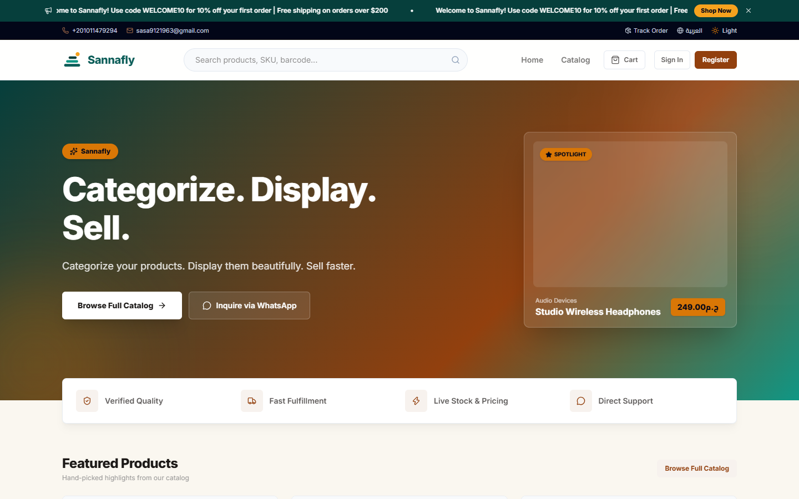 | 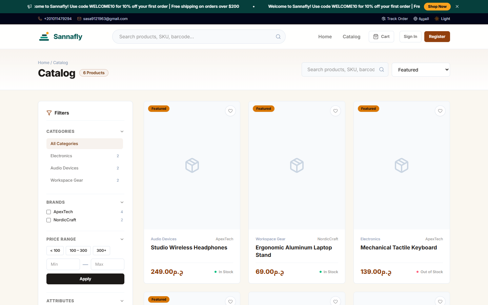 |

| الصفحة التعريفية للمنتج (`/product`) | مركز التجربة الحية الآمن (`/demo`) |
| :---: | :---: |
| 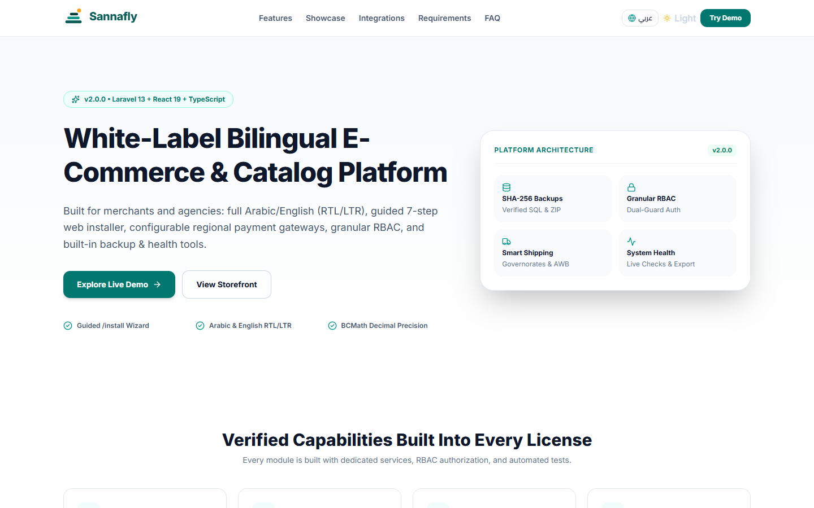 | 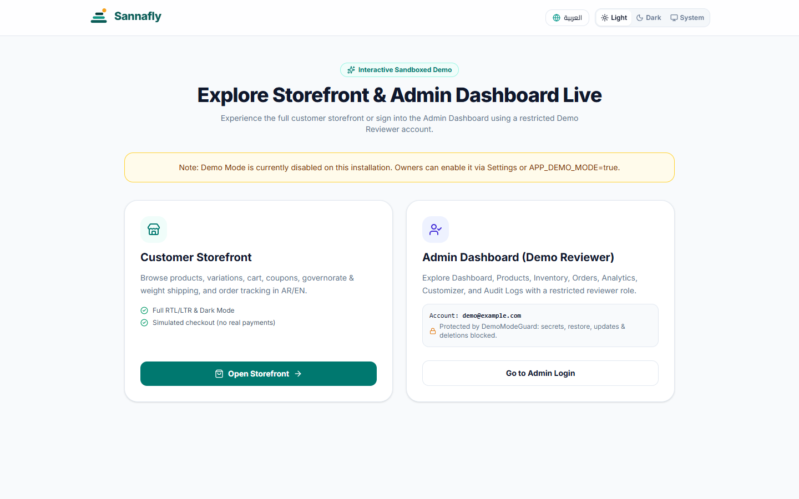 |

### لوحة التحكم وإدارة المتجر
| لوحة التحكم الرئيسية (`/admin`) | إدارة المنتجات (`/admin/products`) |
| :---: | :---: |
| 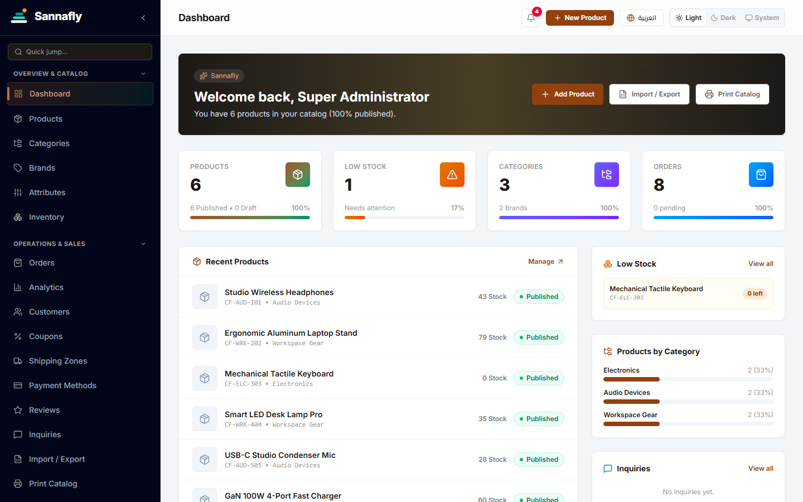 | 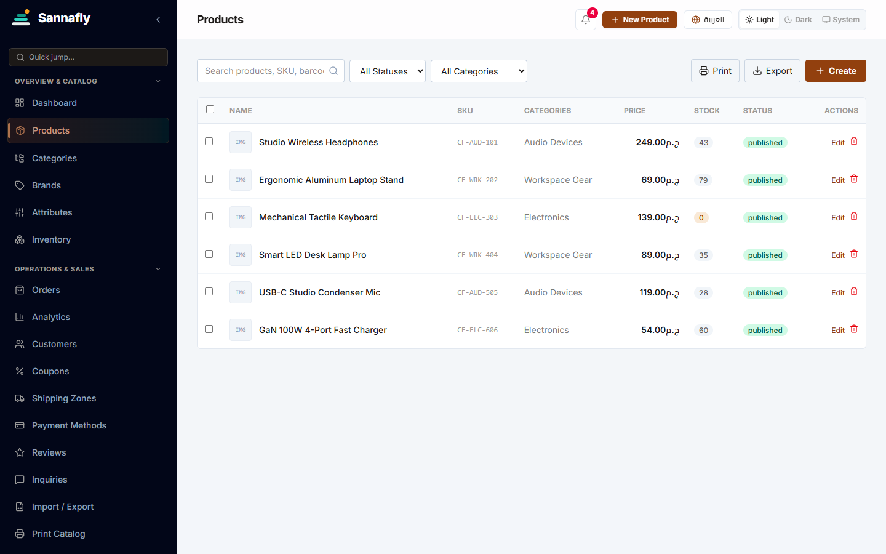 |

| معالج إضافة المنتج من 5 خطوات (`/admin/products/create`) | مخصص المتجر المباشر (`/admin/customizer`) |
| :---: | :---: |
| 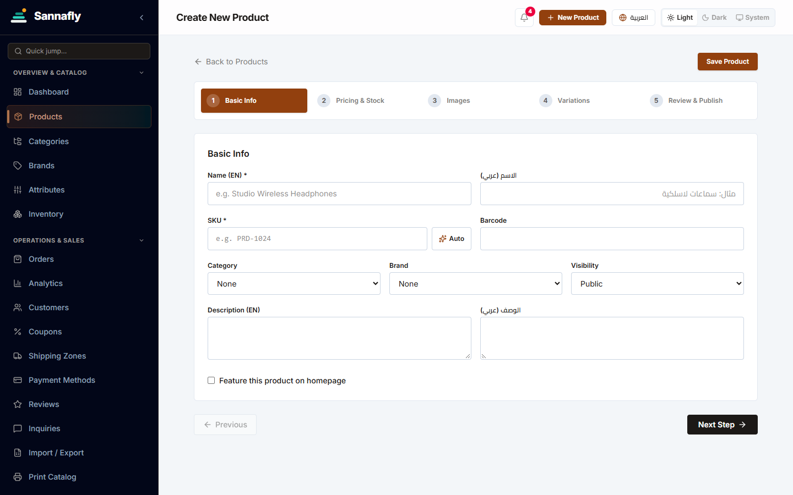 | 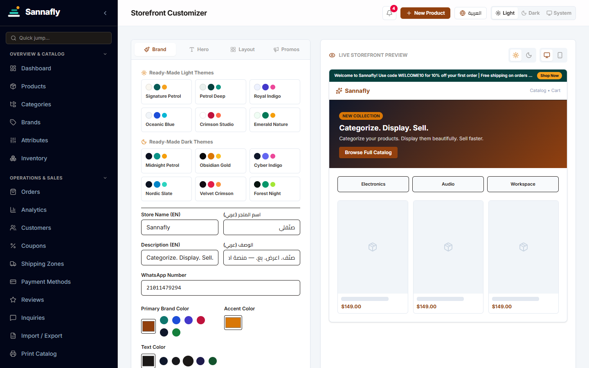 |

| إدارة الطلبات (`/admin/orders`) | تحليلات المبيعات (`/admin/analytics`) |
| :---: | :---: |
| 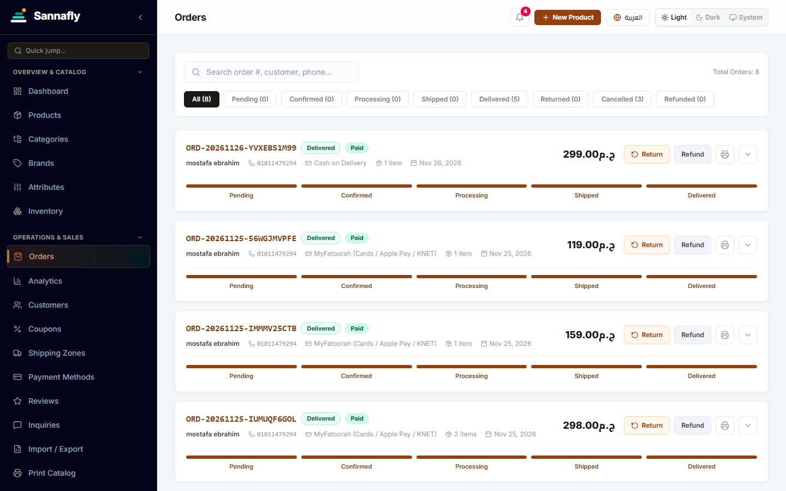 | 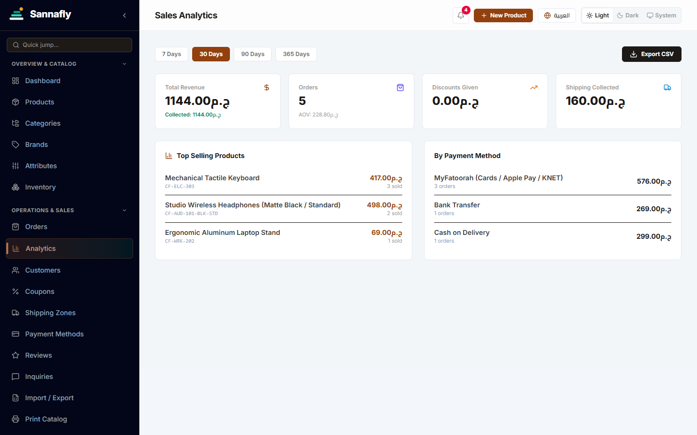 |

### الإدارة التجارية والأمان والصيانة
| بوابات الدفع (`/admin/payment-methods`) | النسخ الاحتياطي والاستعادة (`/admin/system/backups`) |
| :---: | :---: |
| 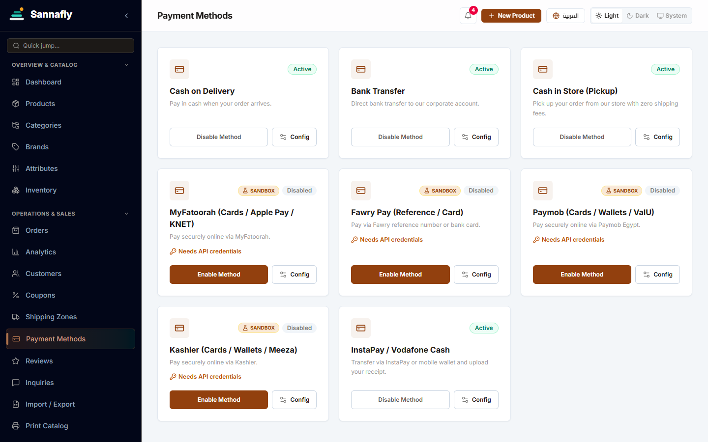 | 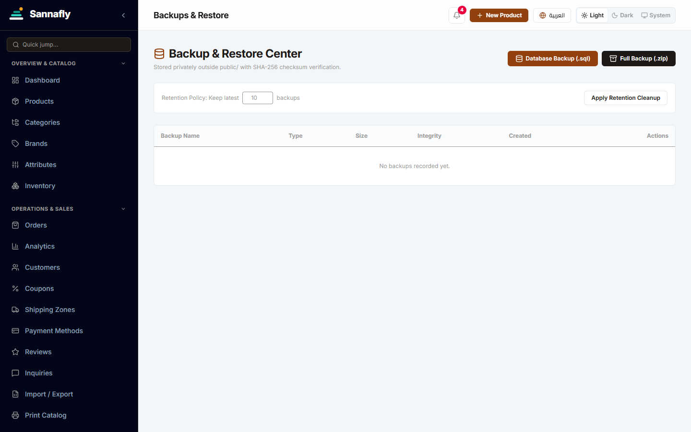 |

| صحة النظام والتشخيص (`/admin/system/health`) | التراخيص التجارية (`/admin/system/license`) |
| :---: | :---: |
| 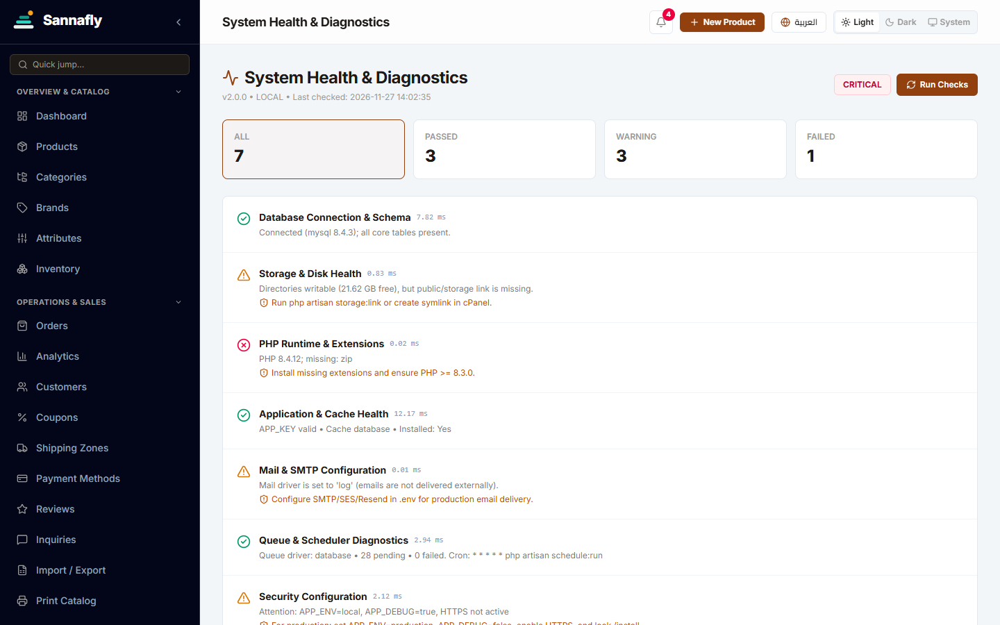 | 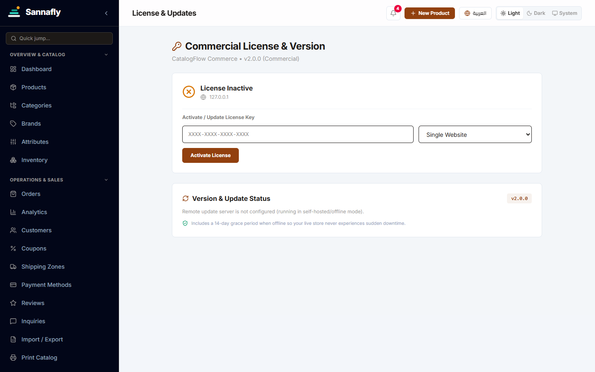 |

---

## ✨ المميزات الرئيسية

### 🎨 الهوية البيضاء والتخصيص (White-Label & Customizer)
- تخصيص كامل لاسم المتجر، الشعارات (النهاري/الليلي)، الأيقونة المفضلة، العملة، المنطقة الزمنية، وتنسيق الأرقام والتاريخ من `/admin/settings`.
- **مخصّص مرئي بـ 4 تبويبات** (`/admin/customizer`) مع معاينة مباشرة للكمبيوتر والموبايل والوضعين الفاتح والداكن.
- **قوالب ثيم جاهزة** (`/admin/customizer/themes`) مع إمكانية الحفظ والتطبيق والتصدير والاستيراد بصيغة JSON.
- **ثنائي اللغة والاتجاه**: دعم كامل للعربية (`RTL`) والإنجليزية (`LTR`)، مع **Dark / Light / System Mode**.
- **صفحات أخطاء متناسقة مع الثيم**: (`403`, `404`, `419`, `429`, `500`, `503`) عبر Inertia وBlade.

### 📦 الكتالوج والمخزون والتسعير
- **معالج منتج من 5 خطوات**: البيانات الأساسية، الأسعار والمخزون، معرض الصور، المتغيرات، والمراجعة والنشر.
- **تسعير متعدد المستويات** (`regular`, `sale`, `wholesale`, `vip`) مع دعم الحد الأدنى للكمية (`min_quantity`).
- **إدارة المخزون** (`/admin/inventory`): سجل حركات غير قابل للتعديل (`StockMovement`) مع حجز وتحرير تلقائي عند الطلب والإلغاء.
- **استيراد وتصدير مجمع** (`/admin/import-export`): قوالب `CSV` و`XLSX` مع معاينة التحقق وتقرير أخطاء لكل صف، بالإضافة لطباعة الكتالوج وورقة المنتج.

### 🛒 الطلبات والدفع والشحن
- **دورة حياة منضبطة للطلب (Order State Machine)**: `pending → confirmed → processing → shipped → delivered` مع دعم `cancelled`, `returned`, `refunded` وطباعة الفاتورة وملصق الشحن.
- **6 طرق دفع مدعومة**: الدفع عند الاستلام (`cod`)، التحويل البنكي (`bank_transfer`)، `MyFatoorah`، `Fawry`، `Paymob`، و`Kashier`.
- **مناطق الشحن والكوبونات**: شحن مجاني حسب الحد الأدنى للطلب، وكوبونات خصم نسبة أو مبلغ ثابت.

### 🛡️ الأمان والإدارة التجارية
- **عزل الحراس (Guard Isolation)**: فصل كامل بين حسابات الإدارة (`web`) وحسابات العملاء (`customer`).
- **RBAC تفصيلي**: أدوار وصلاحيات دقيقة (`/admin/roles`, `/admin/users`) مع سجل تدقيق (`/admin/system/audit-logs`) وسجلات النظام (`/admin/system-logs`).
- **أدوات التشغيل التجارية**: معالج التثبيت الموجه (`/install`)، صحة النظام (`/admin/system/health`)، النسخ الاحتياطي والاستعادة (`/admin/system/backups`)، التحديثات (`/admin/system/updates`)، إدارة التراخيص (`/admin/system/license`)، وحزمة دعم فني منزوعة الأسرار (`/admin/system/support`).
- **وضع العرض التجريبي (`/demo`)**: حساب مراجعة مقيّد (`demo-reviewer`) وحماية `demo.guard` تمنع التعديلات الحساسة وتُحاكي الدفع الإلكتروني بأمان.
- **مركز تعلم تفاعلي داخل لوحة التحكم (`/admin/help`)**: أدلة مصوّرة قابلة للبحث، تتبع التقدم، المفضلة، والأسئلة الشائعة.

---

## 🚀 التثبيت السريع (Quick Start)

### 1. التثبيت عبر المتصفح (موصى به للاستضافة المشتركة والعملاء)
1. ارفع ملفات المشروع، وجّه النطاق إلى مجلد `public/`، وتأكد من صلاحيات الكتابة لمجلدي `storage/` و`bootstrap/cache/`.
2. افتح `https://your-domain.com/install` واتبع الخطوات الخمس (اختبار قاعدة البيانات، حفظ `.env`، تشغيل التهجير والبذور، إنشاء حساب المالك).
3. بعد الانتهاء، يتم قفل `/install` تلقائيًا ويمكنك الدخول من `/admin/login`.

### 2. التثبيت المحلي للمطورين (CLI)
```bash
git clone <repository-url>
cd sannafly
composer install
npm install
cp .env.example .env
php artisan key:generate
php artisan migrate --seed
php artisan storage:link
npm run build
php artisan serve
```

---

## 🧪 الاختبارات وجودة الكود (Testing & QA)

```bash
# فحص تنسيق PHP
php ./vendor/bin/pint --test

# فحص أنواع TypeScript
npx tsc --noEmit

# اختبارات الواجهة (Vitest)
npm test

# بناء الإنتاج
npm run build

# اختبارات الخادم (Pest - بيئة SQLite)
php artisan test --exclude-group=mysql
```

---

## 📚 التوثيق الكامل

- [فهرس دليل المالك ومركز التعلم](docs/user-guide/README.md)
- [خارطة التعلم (مبتدئ ← متوسط ← متقدم)](docs/user-guide/learning-roadmap.md)
- [دليل التشغيل الكامل حتى تسليم العميل](docs/user-guide/deployment.md)
- [نصوص وسيناريوهات الفيديوهات التعليمية (28 درسًا)](docs/user-guide/video-tutorials.md)
- [دليل حل المشاكل الشائعة](docs/user-guide/troubleshooting.md)
- داخل التطبيق: افتح `/admin/help` بعد تسجيل الدخول.

---

## 📄 الترخيص

هذا المشروع مرخص للاستخدام التجاري وفق بنود الترخيص المرفقة بالنظام.
