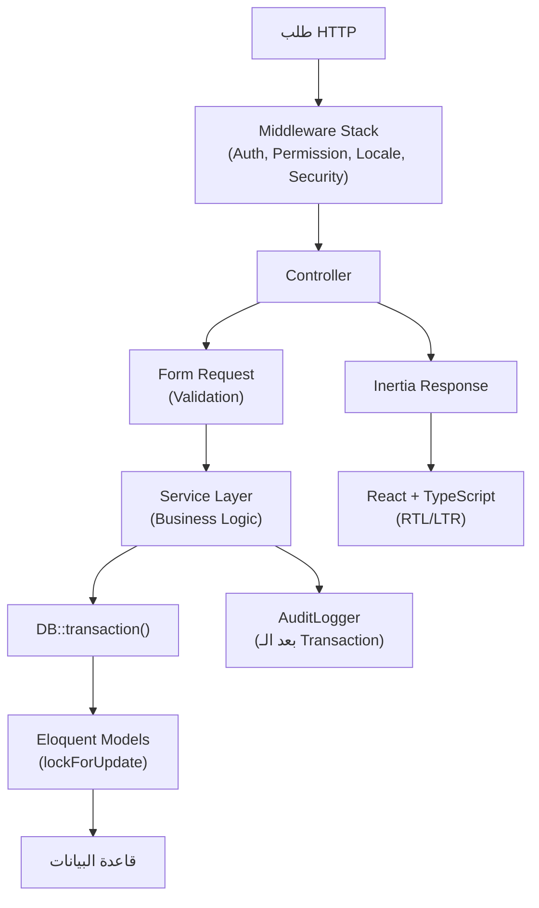

<p align="center">
  <h1 align="center">⚡ CatalogFlow</h1>
  <p align="center">
    منصة كتالوج منتجات وتجارة إلكترونية متكاملة مبنية بـ Laravel 13 + React 19 + TypeScript + Inertia.js
  </p>
  <p align="center">
    
    
    
    
    
    
    
    
  </p>
</p>

---

## 📋 نظرة عامة

**CatalogFlow** هو نظام إدارة كتالوج منتجات احترافي ومتكامل، مصمم للعمل في وضعين:

| الوضع | الوصف |
|---|---|
| 🗂️ **وضع الكتالوج** | عرض المنتجات، المعارض، التسعير المتعدد، المتغيرات، الاستفسارات، WhatsApp |
| 🛒 **وضع التجارة الإلكترونية** | سلة التسوق، الدفع، الطلبات، حسابات العملاء، بوابات الدفع |

يمكن تفعيل أو تعطيل كل وحدة بشكل مستقل من لوحة الإعدادات دون التأثير على باقي الميزات.

---

## ✨ المميزات الرئيسية

### 🏗️ البنية والتقنيات
- **Modular Monolith** – خدمات منفصلة (`Services`), Policies, Form Requests, وصفحات Inertia React
- **Full-Stack Type Safety** – TypeScript من الطرف الأمامي مع Pest للاختبارات الشاملة
- **معالجة آمنة للأموال** – جميع القيم المالية `DECIMAL(15,4)` مع BCMath بدلاً من floating-point
- **ثنائي اللغة والاتجاه** – عربي/إنجليزي (RTL/LTR) في جميع أجزاء النظام

### 🔐 الأمان والصلاحيات
- **RBAC تفصيلي** – نظام أدوار وصلاحيات على مستوى `resource.action`
- **Super Admin** – يتجاوز فحوصات الصلاحيات عبر `Gate::before`
- **حماية من IDOR** – استعلامات محددة النطاق مع فحوصات Policy
- **سجل تدقيق شامل** – تسجيل غير قابل للتعديل لكل الأحداث
- **تشفير كلمات المرور** – Bcrypt/Argon2id مع rate limiting
- **Security Headers** – middleware متخصص لإضافة رؤوس HTTP الأمنية

### 🗄️ قاعدة البيانات والمعاملات
- **معاملات آمنة** – جميع الكتابات المتعددة داخل `DB::transaction()`
- **قفل تشاؤمي** – `lockForUpdate()` بترتيب محدد لمنع Deadlocks والبيع الزائد
- **قيود فريدة** – على `sku`, `slug`, `email`, و`(product_id, variation_hash)`

---

## 🛠️ متطلبات النظام

| المتطلب | الإصدار الأدنى |
|---|---|
| PHP | 8.3+ |
| Composer | 2.x |
| Node.js | 20+ |
| npm | 10+ |
| قاعدة البيانات | MySQL 8+ **أو** SQLite 3.39+ |

---

## 🚀 التثبيت والإعداد

### 1. استنساخ المشروع

```bash
git clone https://github.com/your-username/catalogflow.git
cd catalogflow
```

### 2. إعداد تلقائي (موصى به)

```bash
composer run setup
```

هذا الأمر يقوم بـ:
- تثبيت dependencies الـ PHP
- إنشاء ملف `.env` ونسخه من `.env.example`
- توليد `APP_KEY`
- تشغيل الـ migrations
- تثبيت dependencies الـ Node.js
- بناء الـ assets

### 3. إعداد يدوي

```bash
# PHP dependencies
composer install

# إعداد البيئة
cp .env.example .env
php artisan key:generate

# قاعدة البيانات
php artisan migrate

# Node dependencies وبناء الـ assets
npm install
npm run build
```

### 4. تشغيل بيئة التطوير

```bash
composer run dev
# أو
php artisan serve
npm run dev
```

---

## ⚙️ إعدادات البيئة `.env`

```env
APP_NAME=CatalogFlow
APP_URL=http://localhost:8000
APP_LOCALE=ar          # en | ar

# قاعدة البيانات (SQLite للتطوير، MySQL للإنتاج)
DB_CONNECTION=sqlite
# DB_CONNECTION=mysql
# DB_HOST=127.0.0.1
# DB_PORT=3306
# DB_DATABASE=catalogflow
# DB_USERNAME=root
# DB_PASSWORD=

# البريد الإلكتروني
MAIL_MAILER=smtp
MAIL_HOST=smtp.mailtrap.io
MAIL_FROM_ADDRESS=hello@catalogflow.com
```

---

## 📁 بنية المشروع

```
catalogflow/
├── app/
│   ├── Console/Commands/          # أوامر Artisan المخصصة
│   │   ├── GenerateProductImages.php
│   │   └── ProductionPreflight.php
│   ├── Http/
│   │   ├── Controllers/
│   │   │   ├── Admin/             # 20+ متحكم للوحة التحكم
│   │   │   ├── Auth/              # AuthController, CustomerAuthController, PasswordResetController
│   │   │   ├── CartCheckoutController.php
│   │   │   ├── StorefrontController.php
│   │   │   ├── WishlistController.php
│   │   │   └── ProductReviewController.php
│   │   ├── Middleware/
│   │   │   ├── CheckPermission.php       # صلاحيات RBAC
│   │   │   ├── EnsureUserIsActive.php    # حالة الحساب
│   │   │   ├── SecurityHeaders.php       # رؤوس HTTP الأمنية
│   │   │   ├── SetLocale.php            # التبديل بين EN/AR
│   │   │   └── HandleInertiaRequests.php
│   │   └── Requests/              # Form Request Validation
│   ├── Models/                    # 25+ نموذج Eloquent
│   ├── Policies/                  # ProductPolicy, UserPolicy
│   ├── Services/
│   │   ├── AuditLogger.php        # تسجيل أحداث التدقيق
│   │   ├── ImageService.php       # WebP + thumbnails
│   │   ├── InventoryService.php   # حركات المخزون
│   │   ├── OrderService.php       # معالجة الطلبات
│   │   ├── ProductService.php     # CRUD المنتجات
│   │   ├── SettingsService.php    # الإعدادات
│   │   ├── ShippingService.php    # حساب الشحن
│   │   └── Payments/
│   │       ├── PaymentGatewayInterface.php
│   │       ├── PaymentGatewayManager.php
│   │       ├── FawryGateway.php           # بوابة فوري
│   │       └── MyFatoorahGateway.php      # بوابة MyFatoorah
│   └── Notifications/
│       └── OrderStatusNotification.php
│
├── database/
│   └── migrations/
│       ├── extend_users_and_create_rbac_tables
│       ├── create_catalog_core_tables
│       ├── create_variations_and_inventory_tables
│       ├── create_settings_imports_and_ecommerce_tables
│       ├── create_customers_table
│       ├── create_coupons_and_shipping_zones_tables
│       └── create_wishlists_and_reviews_tables
│
├── resources/
│   └── js/
│       ├── Pages/
│       │   ├── Admin/             # لوحة تحكم المشرف
│       │   ├── Auth/              # Login, Register, Password Reset
│       │   └── Storefront/        # الواجهة العامة للمتجر
│       ├── Layouts/               # Admin Layout + Storefront Layout
│       └── Components/            # مكونات React قابلة للإعادة
│
├── routes/
│   └── web.php                    # جميع مسارات التطبيق
│
└── tests/
    └── Feature/                   # 10+ ملفات اختبار Pest
```

---

## 🗃️ قاعدة البيانات

### مجموعات الجداول الأساسية

```
┌─────────────────────────────────────────────────────────────┐
│  المستخدمون والصلاحيات                                       │
│  users · roles · permissions · role_permission              │
│  user_role · user_permission · audit_logs                   │
├─────────────────────────────────────────────────────────────┤
│  الكتالوج الأساسي                                            │
│  categories (شجرة متداخلة) · brands · products             │
│  product_images · price_types · product_prices              │
├─────────────────────────────────────────────────────────────┤
│  المتغيرات والمخزون                                          │
│  attributes · attribute_options · product_variations        │
│  variation_attribute_options · stock_movements              │
├─────────────────────────────────────────────────────────────┤
│  الإعدادات والتخصيص                                          │
│  settings · storefront_themes · custom_pages                │
├─────────────────────────────────────────────────────────────┤
│  الاستيراد والتصدير                                          │
│  import_jobs · import_errors                                │
├─────────────────────────────────────────────────────────────┤
│  التجارة الإلكترونية (اختياري)                               │
│  payment_methods · carts · cart_items · orders · order_items│
│  payments · product_inquiries · customers · customer_addresses│
│  coupons · shipping_zones · wishlists · product_reviews     │
└─────────────────────────────────────────────────────────────┘
```

---

## 🧩 الوحدات والميزات

### 🔑 إدارة المستخدمين والصلاحيات (Phase 2)

| الميزة | التفاصيل |
|---|---|
| نظام RBAC | أدوار وصلاحيات تفصيلية بمستوى `resource.action` |
| حالة الحساب | `active` / `inactive` / `suspended` |
| سجل التدقيق | تسجيل الممثل، الإجراء، الـ IP، User Agent |
| Rate Limiting | 5 محاولات/دقيقة لكل بريد إلكتروني + IP |
| Session Security | إعادة توليد Session عند تسجيل الدخول/الخروج |

**الصلاحيات المتاحة:**
```
products.view | products.create | products.edit | products.delete
users.view | users.create | users.edit | users.delete | users.manage_roles
orders.view | orders.manage | inventory.view | inventory.manage
settings.view | settings.manage | audit_logs.view | payments.manage
inquiries.manage
```

---

### 🛍️ إدارة المنتجات (Phase 3 & 4)

**الكتالوج الأساسي:**
- 📂 **الفئات** – شجرة متداخلة، صورة، SEO، الترتيب، الظهور
- 🏷️ **الماركات** – شعار، وصف، SEO، الظهور
- 📦 **المنتجات** – اسم، slug، SKU، باركود، وصفات، حالة، تمييز، SEO، مواصفات، حقول مخصصة

**الصور:**
- رفع متعدد مع إعادة ترتيب بالسحب والإفلات
- تحويل تلقائي إلى WebP + thumbnails عبر `ImageService`
- تجريد EXIF ومعالجة الـ payloads الخبيثة

**التسعير المتعدد:**
- أنواع أسعار متعددة (`price_types`)
- أسعار حسب الكمية (tiers)
- تخزين آمن بـ `DECIMAL(15,4)`

**المتغيرات والمخزون:**
- سمات (`attributes`) وخيارات (`attribute_options`)
- مولّد تلقائي للتركيبات Cartesian مع `combination_hash` لمنع التكرار
- حركات المخزون (`stock_movements`) مع قفل تشاؤمي `lockForUpdate()`
- حدود المخزون المنخفض وخيار backorder

---

### 🌐 الواجهة العامة (Storefront) (Phase 5)

| الصفحة | الميزات |
|---|---|
| 🏠 الرئيسية | Hero قابل للتهيئة، منتجات مميزة، فئات، ماركات |
| 📋 الكتالوج | بحث من الخادم، فلاتر متعددة، ترتيب، pagination |
| 📄 تفاصيل المنتج | معرض صور، محدد المتغيرات، أسعار متعددة، منتجات مشابهة |
| 💬 الاستفسار | نموذج استفسار + WhatsApp مباشر |

---

### 🖥️ لوحة التحكم (Phase 6)

- 📊 **Widgets** – إحصائيات المنتجات، المخزون المنخفض، النشاط الأخير
- 📋 **جدول المنتجات** – بحث، فلاتر، ترتيب، إجراءات جماعية، إخفاء/إظهار الأعمدة
- ⚙️ **الإعدادات** – تهيئة موجهة وتبديل الوحدات

---

### 📥 الاستيراد والتصدير (Phase 7)

| العملية | الصيغ | الميزات |
|---|---|---|
| **تصدير** | CSV، Excel (XLSX) | تصفية مخصصة، تعقيم formula injection |
| **استيراد** | CSV، Excel (XLSX) | تحميل القالب، معاينة، validation، معالجة الـ chunks، تقرير الأخطاء |

---

### 🖨️ الطباعة (Phase 8)

قوالب طباعة مخصصة بدون Chrome الـ dashboard:
- 📚 كتالوج المنتجات
- 💰 قائمة الأسعار
- 📦 تقرير المخزون
- 🏷️ ملصقات الباركود والمنتجات
- 📄 تفاصيل منتج مفرد

جميع القوالب تدعم العربية/الإنجليزية وRTL/LTR.

---

### 🎨 تخصيص الواجهة (Phase 9)

- لوجو وـ Favicon
- الألوان والخطوط
- رأس وتذييل الصفحة
- الأقسام والمحتوى
- معاينة حية قبل النشر

---

### 🛒 التجارة الإلكترونية (Phase 10 - اختياري)

**ميزات العملاء:**
- تسجيل دخول/خروج منفصل للعملاء
- إدارة ملف شخصي وعناوين
- سلة تسوق وقائمة أمنيات (Wishlist)
- مراجعات وتقييمات المنتجات
- تتبع الطلبات

**معالجة الطلبات:**
- حجز المخزون عند الطلب وإلغاء الحجز عند الإلغاء
- Idempotency Keys لمنع التكرار
- إشعارات حالة الطلب

**الكوبونات والشحن:**
- أكواد خصم مع قواعد تطبيق
- مناطق شحن بأسعار مختلفة

**بوابات الدفع:**
```
├── Fawry (فوري)
├── MyFatoorah (ماي فاتورة)
└── واجهة قابلة للتوسعة (PaymentGatewayInterface)
```

---

## 🔒 الأمان

| الطبقة | التفاصيل |
|---|---|
| **المصادقة** | Bcrypt/Argon2id، rate limiting، رسائل خطأ عامة (بدون تعداد الحسابات) |
| **التفويض** | RBAC تفصيلي + Policies + middleware `permission:` |
| **المدخلات** | FormRequest validation صارمة، لا mass assignment |
| **الصور** | التحقق من MIME وإعادة الترميز لتجريد EXIF والـ payloads |
| **الاستيراد** | تعقيم formula injection وفحص MIME/الحجم |
| **سجل التدقيق** | تسجيل غير قابل للتعديل، كلمات المرور والـ tokens مُعقَّمة |
| **المدفوعات** | أسرار الـ gateway مشفرة من جانب الخادم فقط |
| **الـ Headers** | SecurityHeaders middleware |

---

## 🧪 الاختبارات

```bash
# تشغيل جميع الاختبارات
composer run test

# أو مباشرة
php artisan test
```

### ملفات الاختبار

| الملف | ما يختبره |
|---|---|
| `AuthAndRbacTest` | المصادقة، الصلاحيات، RBAC |
| `ProductAndVariationTest` | المنتجات، المتغيرات، الصور، التسعير |
| `InventoryAndOrderTransactionTest` | المخزون، الطلبات، المعاملات |
| `ImportExportAndPrintTest` | الاستيراد/التصدير، قوالب الطباعة |
| `PaymentGatewayTest` | بوابات الدفع والـ callbacks |
| `AdminPagesAndModerationTest` | صفحات الإدارة والإشراف |
| `StorefrontAndLocalizationTest` | الواجهة العامة والتعريب |
| `StorefrontEnhancementsTest` | Wishlist، المراجعات، تتبع الطلبات |
| `PoliciesAndPasswordResetTest` | Policies، إعادة تعيين كلمة المرور |

---

## 🌍 الدعم متعدد اللغات

```php
// تبديل اللغة عبر URL
GET /locale/ar  // → يحول النظام إلى العربية RTL
GET /locale/en  // → يحول النظام إلى الإنجليزية LTR
```

- جميع واجهات المستخدم (Admin + Storefront + Print) تدعم AR/EN
- التبديل الديناميكي لاتجاه الصفحة RTL/LTR
- ملفات ترجمة في `lang/ar/` و `lang/en/`

---

## 📜 الأوامر المتاحة (Artisan)

```bash
# توليد صور المنتجات
php artisan products:generate-images

# فحص ما قبل الإنتاج
php artisan app:production-preflight

# تنظيف الـ cache
php artisan config:clear
php artisan cache:clear
php artisan view:clear
```

---

## 🗺️ خريطة المسارات

### المسارات العامة (Storefront)
```
GET  /                          → الصفحة الرئيسية
GET  /catalog                   → كتالوج المنتجات
GET  /products/{slug}           → تفاصيل المنتج
POST /inquiries                 → إرسال استفسار
GET  /locale/{locale}           → تبديل اللغة
GET  /about | /contact          → صفحات ثابتة
GET  /sitemap.xml               → خريطة الموقع
```

### مسارات التجارة الإلكترونية
```
GET/POST /cart                  → إدارة السلة
POST     /checkout              → إتمام الشراء
GET      /orders/confirmation/  → تأكيد الطلب
GET      /track-order           → تتبع الطلب
```

### لوحة التحكم (Admin - تتطلب مصادقة)
```
/admin/dashboard                → لوحة التحكم
/admin/products                 → إدارة المنتجات
/admin/categories               → الفئات
/admin/brands                   → الماركات
/admin/inventory                → المخزون
/admin/orders                   → الطلبات
/admin/users                    → المستخدمون
/admin/roles                    → الأدوار والصلاحيات
/admin/audit-logs               → سجل التدقيق
/admin/settings                 → الإعدادات
/admin/customizer               → تخصيص الواجهة
/admin/import-export            → الاستيراد/التصدير
/admin/print/*                  → قوالب الطباعة
```

---

## 🏗️ المبادئ المعمارية



---

## 📦 التقنيات والمكتبات

### Backend
| المكتبة | الإصدار | الغرض |
|---|---|---|
| `laravel/framework` | ^13.17 | إطار العمل الأساسي |
| `inertiajs/inertia-laravel` | ^3.8 | الجسر بين Laravel وReact |
| `intervention/image` | ^4.4 | معالجة الصور وWebP |
| `shuchkin/simplexlsx` | ^1.1 | قراءة ملفات Excel |
| `shuchkin/simplexlsxgen` | ^1.5 | إنشاء ملفات Excel |
| `pestphp/pest` | ^4.7 | إطار الاختبار |

### Frontend
| المكتبة | الإصدار | الغرض |
|---|---|---|
| `react` | ^19.3.1 | مكتبة واجهة المستخدم |
| `@inertiajs/react` | ^3.11.0 | Inertia React adapter |
| `typescript` | ^7.0.2 | Type safety |
| `tailwindcss` | ^4.0.0 | نظام التنسيق |
| `lucide-react` | ^1.80.0 | أيقونات |
| `vite` | ^8.0.0 | أداة البناء |

---

## 🤝 المساهمة

```bash
# 1. Fork المشروع
# 2. أنشئ branch جديد
git checkout -b feature/amazing-feature

# 3. أجرِ تغييراتك
# 4. شغّل الاختبارات
composer run test

# 5. افحص TypeScript
npx tsc --noEmit

# 6. أرسل Pull Request
```

---

## 📄 الترخيص

هذا المشروع مرخص تحت [MIT License](LICENSE).

---

<p align="center">
  صُنع بـ ❤️ باستخدام Laravel + React + TypeScript
</p>
