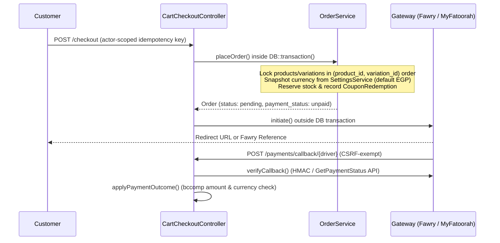

# Payments & Order Lifecycle

## Overview
Sannafly supports offline payment drivers (`cod`, `cash`, `bank_transfer`) and Egyptian-market online payment gateways (`fawry`, `myfatoorah`) via `App\Services\Payments\PaymentGatewayInterface`.

## Payment Flow

## Security & Reliability Controls
- **CSRF Exclusion:** `payments/callback/*` is excluded in `bootstrap/app.php` via `$middleware->validateCsrfTokens(except: ['payments/callback/*'])`. `GET /payments/return/{driver}` never changes order state without verified gateway signature/API confirmation.
- **Currency Snapshot & Validation:** Orders snapshot `general.currency` (default `EGP`). `FawryGateway::initiate` rejects any non-`EGP` order; `MyFatoorahGateway::initiate` validates against supported ISO currencies.
- **Amount & Currency Verification:** `applyPaymentOutcome` compares the gateway-reported `amount` (scale 2 via `bccomp`) and `currency` against the order. Mismatches are flagged as `amount_mismatch`, audited (`payment.amount_mismatch`), and never mark the order paid.
- **Out-of-Order Callbacks:**
  - `failed` arriving after `completed` is ignored and audited (`payment.out_of_order_ignored`).
  - `completed` arriving after `cancelled` flags the order/payment as `needs_review` and audits `payment.completed_after_cancel`.
- **Unpaid Order Expiry:** `orders:expire-unpaid` runs every 5 minutes (`routes/console.php`) using row-level `lockForUpdate()`, cancelling expired unpaid orders and releasing stock and coupon redemptions.
- **Refunds & Cancellations:** Cancelling a paid online order sets `payment_status = refund_pending` (and optionally calls `PaymentGatewayInterface::refund()` after commit when `auto_refund` is enabled). `shipped -> cancelled` is disallowed (see `DECISIONS.md` ADR-001).
- **Money Precision:** All monetary arithmetic uses `App\Support\Money` (BCMath on `DECIMAL(15,4)` strings, half-up rounding at 4 decimals internally and 2 decimals for gateway display).
