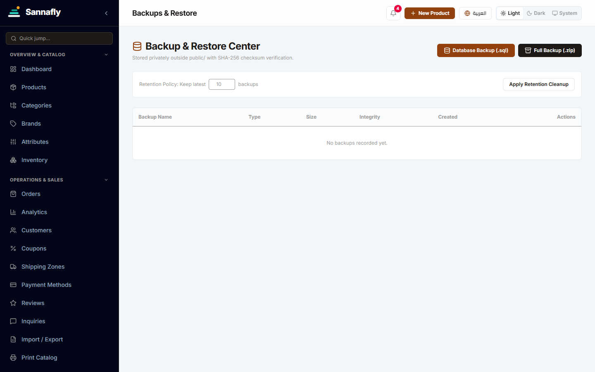
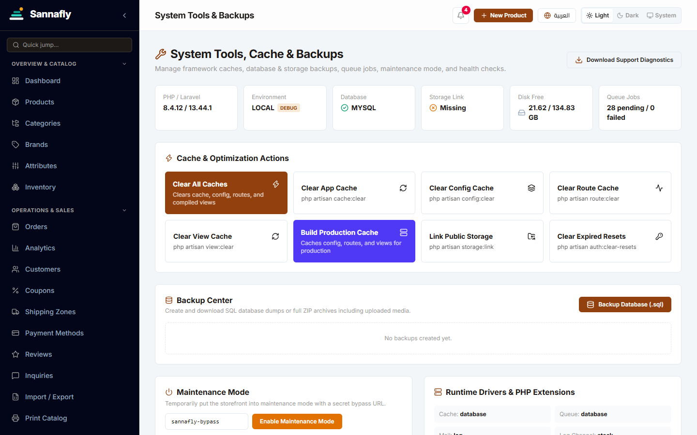

# Backup, Restore & Maintenance Tools

## 1. What is this section?
- **Backups & Restore** (`/admin/system/backups`): Create database or full backups, verify integrity checksums, download archives, restore snapshots, and prune old backups.
- **System Tools** (`/admin/system-tools`): Quick maintenance actions (cache clear, config/view/route optimization, maintenance mode toggle, legacy backup tools).

## 2. Why do I need it?
Always create a verified backup before running updates, bulk imports, or major configuration changes so you can recover safely on Shared Hosting or VPS.

## 3. How do I access it?
- **Backups & Restore:** Sidebar → **System & Security** → **Backups & Restore** (`/admin/system/backups`, `system.backups.*` or `settings.manage`)
- **System Tools:** Sidebar → **System & Security** → **System Tools** (`/admin/system-tools`, `settings.manage`)

*Backups & Restore console (`/admin/system/backups`) with Create, Verify, Download, Restore, Prune, and Delete controls.*

*System Tools (`/admin/system-tools`) for cache management and operational utilities.*

## 4. How to use it step by step
1. Open `/admin/system/backups`.
2. Select backup type (**Database** or **Full**) and click **Create Backup**.
3. Click **Verify** on any backup row to confirm archive integrity.
4. Click **Download** to store an off-site copy on your computer.
5. To restore, click **Restore** on a verified backup and confirm.
6. Use **Prune Old Backups** to enforce `backup_retention_count` from Settings.

## 5. Important notes
- Creating, restoring, pruning, and deleting backups are blocked in Demo Mode (`demo.guard`).
- Restoring a database backup overwrites current data since that snapshot—always download a fresh backup first.

## 6. Common problems
- **Full backup fails on shared hosting:** Use **Database** backup type if `ZipArchive` or disk quota is limited on your host.
