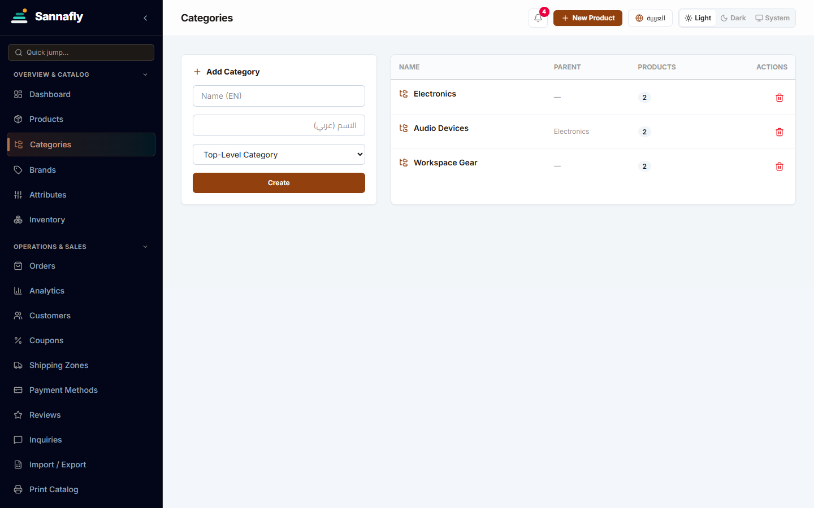
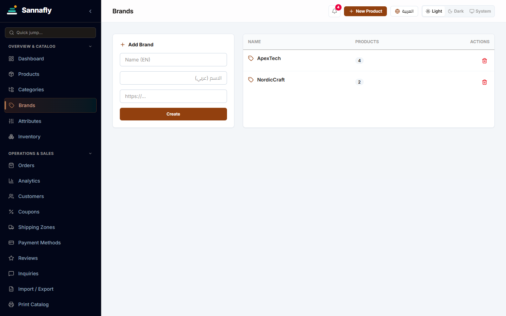

# Categories & Brands

## 1. What is this section?
**Categories** (`/admin/categories`) and **Brands** (`/admin/brands`) organize your products into structured hierarchies and manufacturer/brand collections for easier browsing and filtering.

## 2. Why do I need it?
Customers use categories and brands to filter the storefront catalog (`/catalog`), and the homepage displays dedicated Category and Brand sections when enabled in the Customizer.

## 3. How do I access it?
- **Categories:** Sidebar → **Overview & Catalog** → **Categories** (`/admin/categories`, permissions: `categories.view` / `categories.manage`)
- **Brands:** Sidebar → **Overview & Catalog** → **Brands** (`/admin/brands`, permission: `brands.manage`)

*Categories manager (`/admin/categories`) with parent/child hierarchy, bilingual names, and status toggles.*

*Brands manager (`/admin/brands`) with brand logo/name management.*

## 4. Explain the interface
- **Categories Page**: Create/edit category form (English Name, Arabic Name, Parent Category dropdown for subcategories, Image upload, Active toggle, Sort Order) and hierarchical category list with Edit/Delete actions.
- **Brands Page**: Create/edit brand form (English Name, Arabic Name, Logo upload, Active toggle) and brands list with Edit/Delete actions.

## 5. How to use it step by step
1. Open `/admin/categories`.
2. Fill in **Name (EN)** (e.g., `Audio`) and **Name (AR)** (e.g., `أجهزة صوتية`).
3. Leave **Parent** empty for a top-level category, or pick an existing category to create a subcategory.
4. Click **Save**.
5. Repeat the same flow in `/admin/brands` to add your product brands.

## 6. Practical example
Create a parent category **Electronics**, then create a child category **Keyboards & Mice** with **Parent = Electronics**. Assign products to **Keyboards & Mice** so shoppers can filter by either.

## 7. What happens after I perform the action?
Active categories and brands appear immediately in the Product Wizard dropdowns, Storefront filters, and Homepage sections.

## 8. Important notes
- Deleting categories or brands is blocked in Demo Mode (`demo.guard`).
- You can hide the Brands module globally by disabling `module_brands` in **Settings**.

## 9. Common problems
- **Brand not showing on storefront:** Verify the brand is marked **Active** and `show_brands` is enabled in **Customizer → Layout**.
