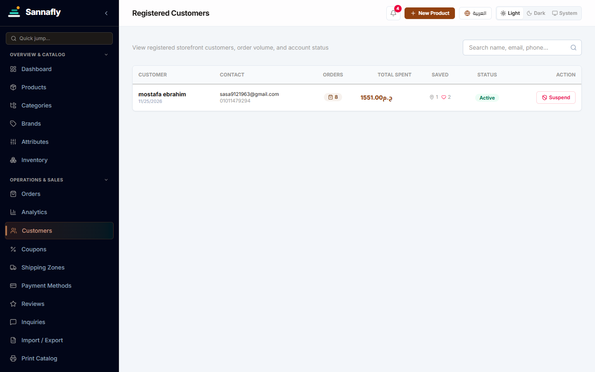
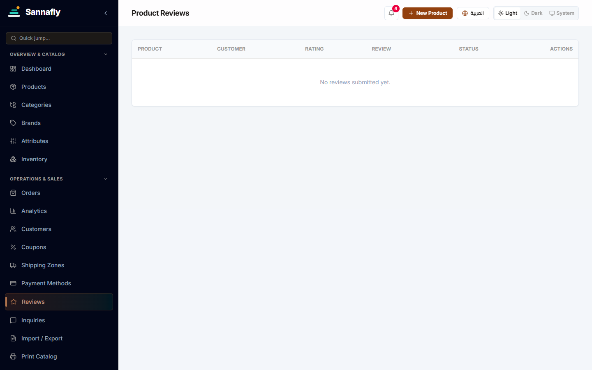
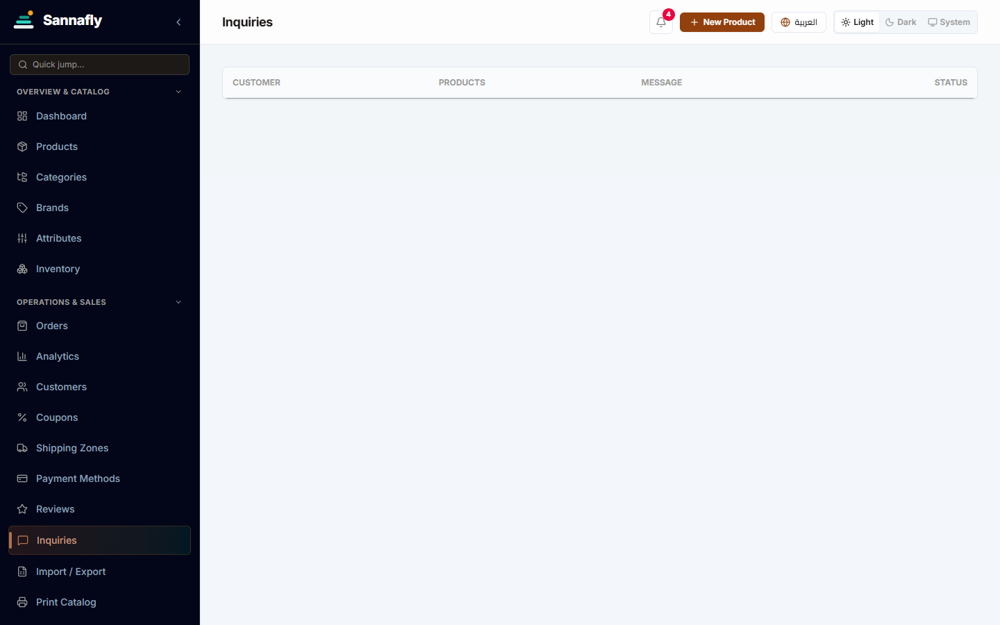

# Customers, Reviews & Inquiries

## 1. What is this section?
- **Customers** (`/admin/customers`): View registered storefront customers, order counts, total spend, and activate/deactivate accounts.
- **Reviews** (`/admin/reviews`): Moderate customer product ratings and reviews before or after publication.
- **Inquiries** (`/admin/inquiries`): Manage pre-sale product questions submitted from product pages or `/contact`.

## 2. Why do I need it?
Keeps customer relationships organized, prevents spam reviews from appearing on product pages, and ensures no sales inquiry goes unanswered.

## 3. How do I access it?
- **Customers:** Sidebar → **Operations & Sales** → **Customers** (`/admin/customers`, `orders.view` / `orders.manage`)
- **Reviews:** Sidebar → **Operations & Sales** → **Reviews** (`/admin/reviews`, `products.edit`)
- **Inquiries:** Sidebar → **Operations & Sales** → **Inquiries** (`/admin/inquiries`, `inquiries.manage`)

*Customers directory (`/admin/customers`) with account status toggle.*

*Product Reviews moderation (`/admin/reviews`).*

*Customer Inquiries inbox (`/admin/inquiries`).*

## 4. Explain the interface
- **Customers**: Searchable table with customer name, email, phone, status badge, and **Toggle Status** action.
- **Reviews**: Shows product, reviewer, star rating (1–5), comment, approval status, **Approve/Hide** toggle, and **Delete** button.
- **Inquiries**: Lists sender name, contact info, related product, message, and status (`new`, `contacted`, `closed`).

## 5. How to use it step by step
1. Open `/admin/inquiries` daily to review `new` inquiries and update their status to `contacted` or `closed` after replying.
2. Open `/admin/reviews` to approve genuine customer reviews or delete spam.
3. Open `/admin/customers` if you need to inspect a buyer's status or temporarily suspend an abusive account.

## 6. Practical example
A visitor asks about bulk pricing on *Studio Headphones* via the product inquiry form. You see it in `/admin/inquiries`, contact them on WhatsApp, and mark the inquiry `contacted`.

## 7. What happens after I perform the action?
Approved reviews appear immediately on `/products/{slug}` and update the product's average rating. Deactivated customers cannot log into the storefront.

## 8. Important notes
- You can restrict storefront reviews to verified buyers only via `reviews_verified_only` in **Settings**.

## 9. Common problems
- **Customer cannot submit a review:** Check if `reviews_verified_only` is enabled in Settings and whether the customer has a delivered/paid order for that product.
