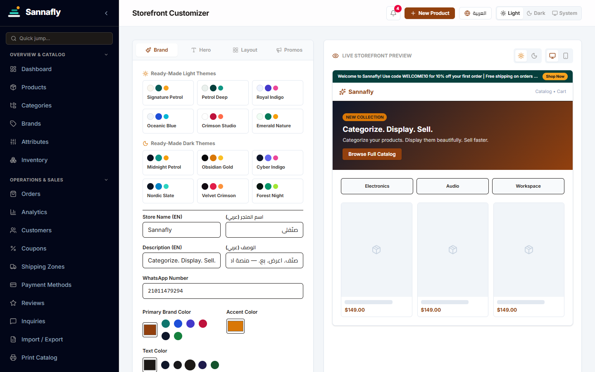
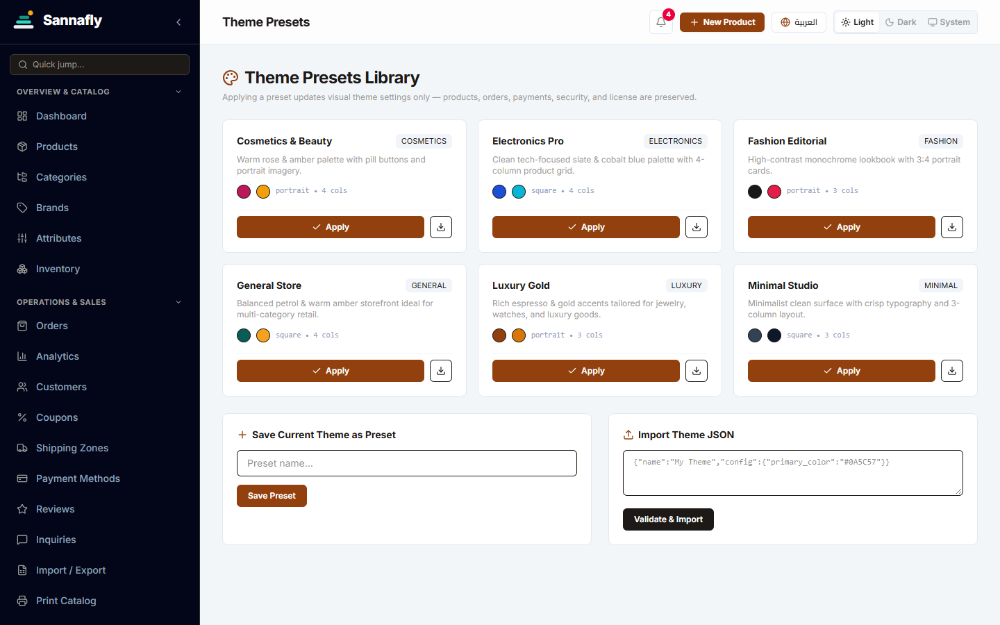
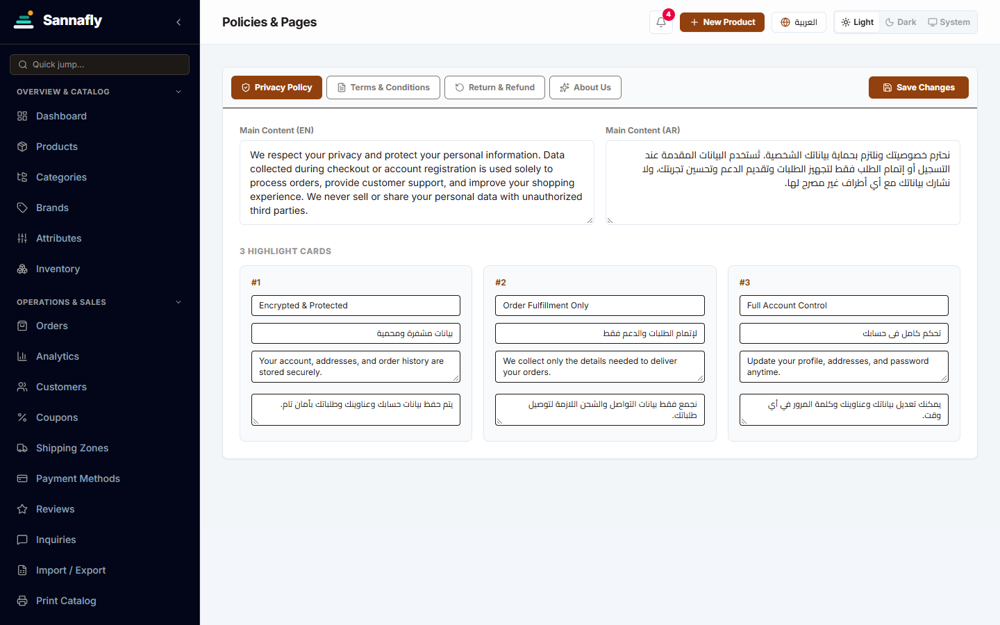

# Storefront Customizer, Theme Presets & Policies

## 1. What is this section?
The **Customizer** (`/admin/customizer`), **Theme Presets Manager** (`/admin/customizer/themes`), and **Policies & Pages** (`/admin/policies`) let you white-label the entire look, layout, colors, and legal pages without touching code.

## 2. Why do I need it?
Every buyer or brand needs unique colors, logos, homepage sections, and legal policies (Privacy, Terms, Refund).

## 3. How do I access it?
- **Customizer:** Sidebar → **System & Security** → **Customizer** (`/admin/customizer`, permission: `settings.manage`)
- **Theme Presets:** Sidebar → **System & Security** → **Theme Presets** (`/admin/customizer/themes`, permission: `customizer.themes.view` / `customizer.themes.manage`)
- **Policies & Pages:** Sidebar → **System & Security** → **Policies & Pages** (`/admin/policies`, permission: `settings.manage`)

*Storefront Customizer (`/admin/customizer`) with 4 configuration tabs and live Desktop/Mobile/Dark-Mode preview.*

*Theme Presets Manager (`/admin/customizer/themes`) for saving, applying, exporting, and importing JSON theme presets.*

*Policies & Pages editor (`/admin/policies`) for bilingual Privacy, Terms, and Return policies.*

## 4. Explain the interface
### Customizer (`/admin/customizer`)
- **4 Tabs**:
  1. **Brand**: Store Name (EN/AR), Description (EN/AR), WhatsApp number, Color pickers (`primary_color`, `accent_color`, `text_color`), Theme Surface (`warm`, `clean`, `slate`, `pure`), Border Radius (`rounded`, `sharp`, `pill`), Niche Presets (Electronics, Fashion, Cosmetics, General, Minimal, Modern, Luxury), and 12 built-in Light/Dark Theme Presets.
  2. **Hero**: Hero Title & Subtitle (EN/AR).
  3. **Layout**: Show/hide toggles (`show_hero`, `show_categories`, `show_featured`, `show_banner`, `show_latest`, `show_brands`), Up/Down buttons to reorder `homepage_sections_order`, Product Grid Columns, Image Ratio.
  4. **Promos**: Seasonal Banner Title/Subtitle/CTA (EN/AR) and link.
- **Live Preview Pane**: Toggle between **Desktop / Mobile** and **Light / Dark** preview before clicking **Save**.

## 5. How to use it step by step
1. Open `/admin/customizer`.
2. Pick a **Niche Preset** or adjust **Primary/Accent Colors** on the **Brand** tab.
3. Switch to **Layout**, toggle sections on/off, and reorder them using the arrow buttons.
4. Preview in **Mobile** and **Dark** mode, then click **Save Changes**.
5. Optionally save your configuration as a reusable preset in `/admin/customizer/themes`.

## 6. Practical example
Apply the **Signature Petrol** preset, set `product_grid_columns = 4`, move `featured` above `categories`, and save.

## 7. What happens after I perform the action?
Settings are persisted in the `settings` table, CSS variables (`--primary`, `--accent`, etc.) update across both Storefront and Admin, and an Audit Log entry is recorded.

## 8. Important notes
- Theme Preset mutations (`store`, `apply`, `import`, `destroy`) are blocked by `demo.guard` when Demo Mode is active.

## 9. Common problems
- **Colors didn't change on storefront:** Hard-refresh (`Ctrl+F5`) or verify you clicked **Save** in the Customizer.
