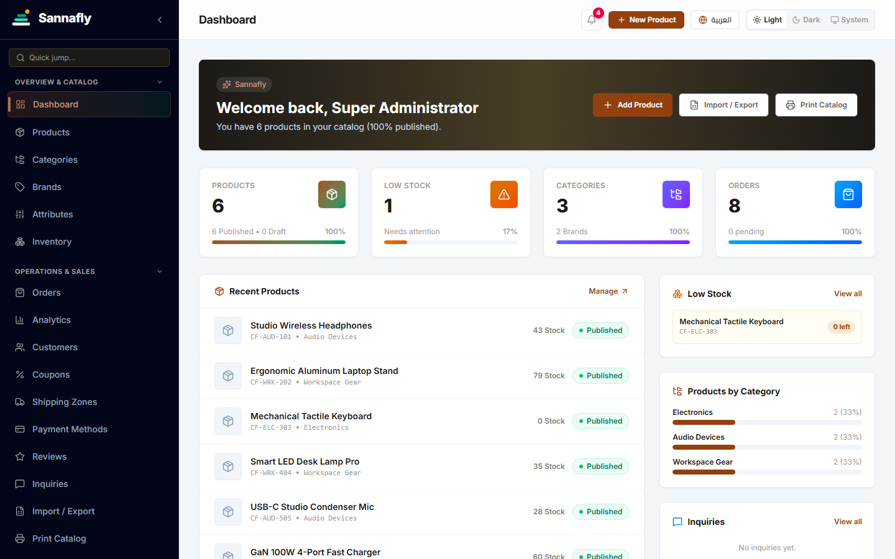
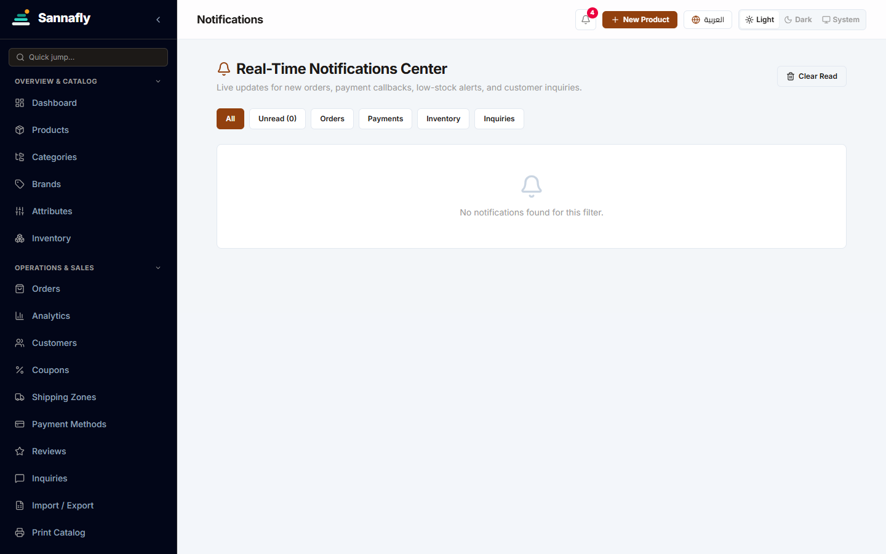

# Dashboard Overview & Navigation

## 1. What is this section?
The **Admin Dashboard** (`/admin`) is your central command center summarizing catalog health, inventory alerts, orders, recent inquiries, and quick operational shortcuts.

## 2. Why do I need it?
It gives store owners and managers an immediate snapshot of what needs attention today (low stock items, pending orders, unread notifications, and recent catalog activity) without opening multiple pages.

## 3. How do I access it?
- **Navigation:** Sidebar → **Overview & Catalog** → **Dashboard**
- **Direct URL:** `/admin`
- **Required Permission:** `dashboard.access`

*Main Admin Dashboard (`/admin`) showing the welcome banner, KPI cards, quick action buttons, and activity panels.*

## 4. Explain the interface
- **Welcome Hero Banner**: Displays your store name, personalized greeting, and quick-action buttons (**Add Product**, **Import & Export**, **Print Catalog** — filtered by your permissions).
- **4 KPI Cards**:
  1. **Products**: Total products with published vs draft breakdown and publish percentage bar.
  2. **Low Stock**: Count of products at or below their low-stock threshold.
  3. **Categories**: Total categories and active brands count.
  4. **Orders** (when `module_ecommerce` is enabled) or **Brands** (in Catalog Mode): Total orders and pending count.
- **Operational Panels**: Low-stock product alerts, recent products, category breakdown, recent customer inquiries, and recent audit activity.
- **Notifications Center (`/admin/notifications`)**: Accessible via the bell icon in the header or **System & Security → Notifications**. Supports live updates, marking individual/all notifications as read, and clearing read notifications.

*Admin Notifications page (`/admin/notifications`) showing live order/system alerts and read/clear controls.*

## 5. How to use it step by step
1. Log into `/admin`.
2. Review the **Low Stock** and **Orders** KPI cards for urgent items.
3. Click **Add Product** in the banner to launch the product wizard, or click any alert item to jump directly to it.
4. Click the **Bell icon** in the top bar (or go to `/admin/notifications`) to review and mark alerts as read.

## 6. Practical example
You open `/admin` in the morning, see **1 Low Stock** item and **2 Pending Orders**. You click **Orders** in the sidebar to confirm the pending orders, then click **Inventory** to restock the low-stock item.

## 7. What happens after I perform the action?
Real-time polling (`/admin/realtime/feed`) automatically updates the unread notification badge and refreshes dashboard/order views when order timestamps change.

## 8. Important notes
- Quick action buttons only appear if your role has the corresponding permission (`products.create`, `products.import`, `products.print`).
- Clicking **My Profile** in the user menu opens `/admin/profile` where you can update your name, email, and password.

## 9. Common problems
- **Orders card is missing:** `module_ecommerce` is disabled in **Settings**. Enable it if you want online orders.
- **Notifications not updating:** Verify your session is active and `/admin/realtime/feed` is not blocked by a reverse proxy.
