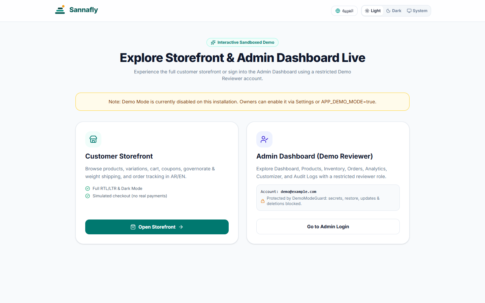

# Demo Mode & Sandboxed Evaluation

## 1. What is this section?
**Demo Mode** lets you showcase the entire platform publicly to prospective buyers without risking your settings, payments, backups, or staff accounts.

## 2. How It Works
- **Live Demo Hub (`/demo`)**: Public bilingual landing hub guiding visitors to the Storefront (`/`) or one-click Admin Demo Reviewer login (`POST /demo/login-admin`).
- **Restricted `demo-reviewer` Role (`demo@example.com`)**: Automatically created/synced when Demo Mode is enabled. Can view Dashboard, Products, Categories, Inventory, Orders, Analytics, Audit Logs, and Theme Presets — **forbidden (`403`)** from Backups, License, Support Export, Users, Payment Methods, and Settings.
- **`demo.guard` Middleware**: Blocks destructive/mutating operations across Settings, Payments, Products/Categories/Brands deletion, Users/Roles deletion, Backups, Updates, License, and Theme Preset mutations.
- **Simulated Checkout**: Online payment gateways (`myfatoorah`, `fawry`, `paymob`, `kashier`) simulate order confirmation without making live API calls.

*Live Demo Hub (`/demo`) allowing prospective customers to test both Storefront and Sandboxed Admin.*

## 3. Managing Demo Mode
- **Toggle On/Off:** `POST /admin/system/demo/toggle` (via System Tools/Settings, permission: `system.demo.manage`).
- **Reset Demo Data:** `POST /admin/system/demo/reset` re-seeds clean demo catalog data.
- **Production Rule:** Always turn Demo Mode **OFF** before handing over a live store to a real customer.
