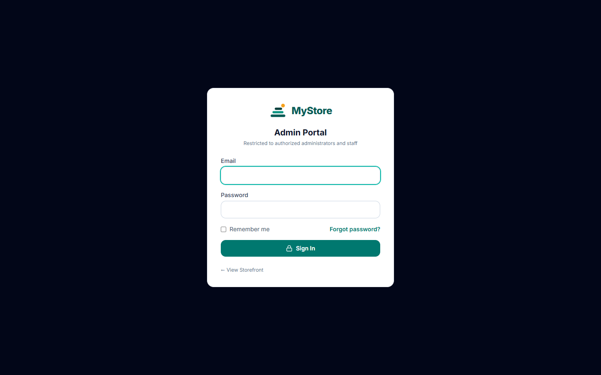

# Getting Started

## 1. What Is This Platform?
This application is a **bilingual (Arabic RTL / English LTR) White-Label Product Catalog & E-Commerce Platform** built on Laravel, Inertia.js, React, and TypeScript. It can operate in two modes controlled from **Settings**:
- **Full E-Commerce Mode** (`module_ecommerce = true`): Full storefront with shopping cart, coupons, shipping zones, guest/registered checkout, COD & online payment gateways, and order tracking.
- **Catalog & Inquiry Mode** (`module_ecommerce = false`): Product showcase with categories, brands, multi-tier pricing, WhatsApp inquiries, and printable catalogs without cart/checkout.

## 2. Accessing the Admin Dashboard
1. Open `/admin/login` in your browser.
2. Enter your staff/administrator **Email** and **Password**.
3. Click **Sign In**.

*The Admin Login screen (`/admin/login`) is completely separated from customer login (`/login`). When Demo Mode is active, a one-click Demo Reviewer button also appears here.*

## 3. Top Header & Sidebar Controls
Once logged in, every dashboard page shares the same layout:
- **Sidebar Quick Search**: Type any page name in the sidebar search box to filter menu items instantly.
- **Collapse Sidebar**: Click the chevron button next to the brand logo to collapse/expand the sidebar (`cf_sidebar_collapsed` is saved in your browser).
- **Theme Mode Toggle**: Switch between **Light**, **Dark**, and **System** appearance in the top bar.
- **Language Switcher**: Toggle between **English (LTR)** and **العربية (RTL)** at any time.
- **Notifications Bell**: Displays live unread notifications and quick alerts for pending orders, review orders, and low-stock products.
- **Visit Storefront**: Opens `/` in a new tab so you can verify changes immediately.

## 4. Key Separation Rules
- **Admin Guard (`web`) vs Customer Guard (`customer`)**: Customer accounts cannot access `/admin/*` (they receive `403 Forbidden`).
- **Role-Based Access Control (RBAC)**: Menu items and actions are automatically shown or hidden based on the logged-in user's assigned role permissions.
