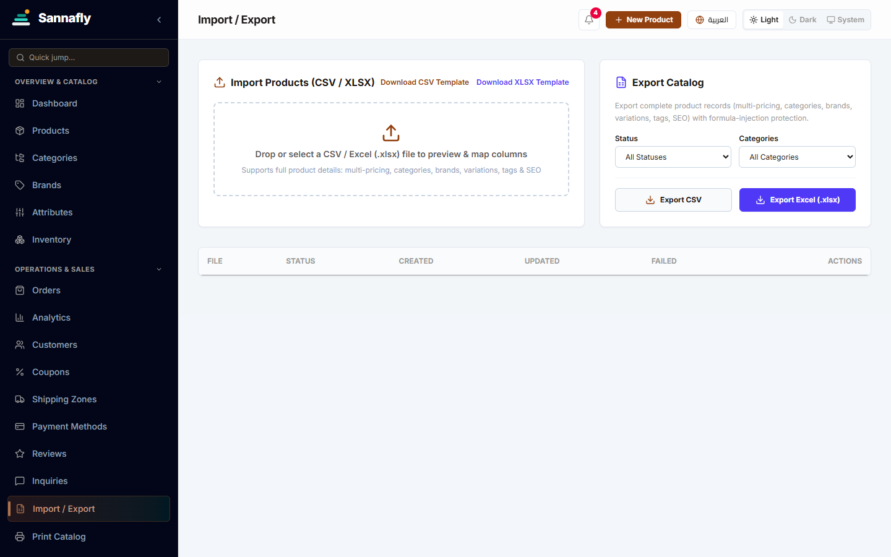

# Bulk Import & Export

## 1. What is this section?
**Import & Export** (`/admin/import-export`) lets you bulk-upload products from CSV/XLSX spreadsheets with a pre-import validation preview, export your existing catalog, and download per-row error reports.

## 2. Why do I need it?
Adding hundreds of products manually takes hours; spreadsheet import lets you onboard an entire catalog or update prices in minutes.

## 3. How do I access it?
- **Navigation:** Sidebar → **Operations & Sales** → **Import & Export**
- **Direct URL:** `/admin/import-export`
- **Required Permissions:** `products.import` and/or `products.export`

*Bulk Import & Export center (`/admin/import-export`) with template download, file preview, import history, and error logs.*

## 4. Explain the interface
- **Download Template**: Download sample `CSV` or `XLSX` template (`/admin/import-export/template/{format}`).
- **Export Catalog**: Export current products (`/admin/import-export/export`).
- **Upload & Preview**: Select file and click **Preview** (`/admin/import-export/preview`) to validate columns and rows before committing.
- **Run Import**: Commits validated rows (`/admin/import-export/import`) and logs an `ImportJob` record.
- **Import History & Error Report**: Shows past import jobs, created/updated/failed counts, and **Download Errors** (`/admin/import-export/jobs/{job}/errors`).

## 5. How to use it step by step
1. Click **Download Template (CSV/XLSX)**.
2. Fill in product rows (`name`, `name_ar`, `sku`, `category`, `regular_price`, `stock_quantity`, etc.).
3. Upload the file and click **Preview** to inspect detected columns and validation warnings.
4. Click **Confirm Import**.
5. If any rows fail, download the **Errors CSV** to fix and re-upload only those rows.

## 6. Practical example
Download the XLSX template, add 50 seasonal items, preview them to catch 1 missing SKU, fix it, and run the import cleanly.

## 7. What happens after I perform the action?
Products and categories/prices are created/updated in the database, and an `ImportJob` audit entry is recorded.

## 8. Important notes
- Always use unique `sku` values so existing products update cleanly instead of failing duplicate checks.

## 9. Common problems
- **Upload rejected:** Ensure file format is `.csv` or `.xlsx` and matches template headers.
