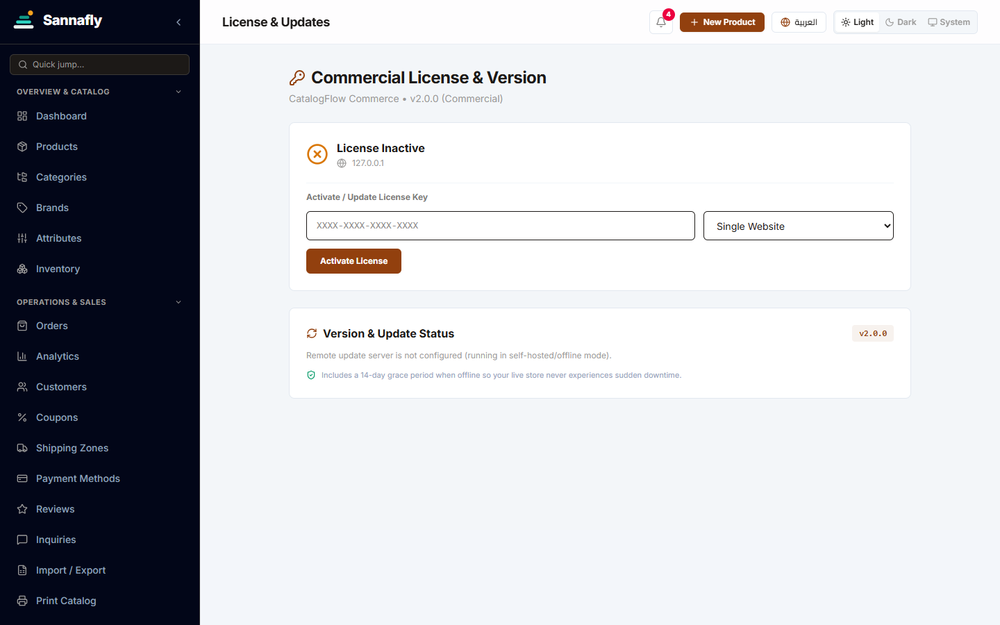
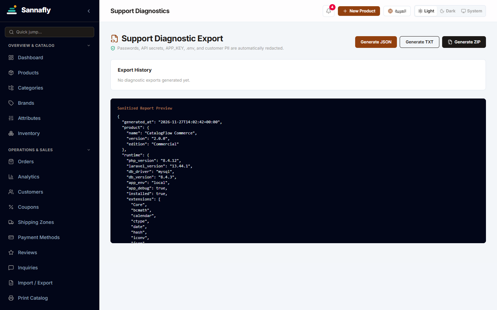

# Commercial Licensing & Support Diagnostics

## 1. What is this section?
- **License Manager** (`/admin/system/license`): View license status, domain binding, plan/edition, and activate or deactivate commercial license keys.
- **Support Diagnostic Export** (`/admin/system/support`): Generates a downloadable, **anonymized** JSON/ZIP diagnostic bundle containing environment info, health report, recent errors, and non-secret settings to share with technical support.

## 2. Why do I need it?
Protects your commercial software distribution with per-domain licensing and eliminates back-and-forth guessing when supporting buyers.

## 3. How do I access it?
- **License:** `/admin/system/license` (`system.license.view` / `settings.manage`)
- **Support Export:** `/admin/system/support` (`system.support.export` / `settings.manage`)

*Commercial License Manager (`/admin/system/license`).*

*Support Diagnostic Export (`/admin/system/support`) for generating and downloading sanitized diagnostic bundles.*

## 4. How to use it step by step
1. Open `/admin/system/license`, enter your buyer's **License Key** and **Domain**, and click **Activate**.
2. If a buyer reports an issue, ask them to open `/admin/system/support`, click **Generate Diagnostic Bundle**, and send you the downloaded file.

## 5. Important notes
- License activation/deactivation is blocked in Demo Mode (`demo.guard`).
- Support bundles intentionally redact secret keys, passwords, and API tokens.
