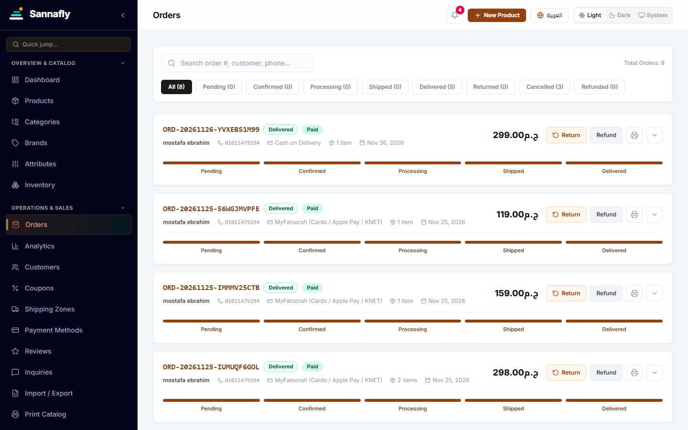
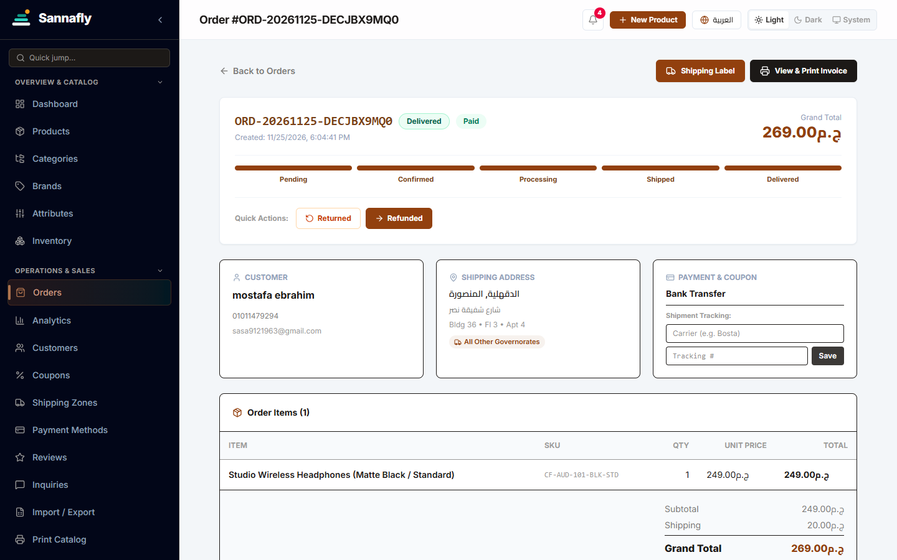

# Orders & Fulfillment

## 1. What is this section?
The **Orders** module (`/admin/orders`) manages incoming customer orders from placement through confirmation, preparation, shipping, delivery, cancellation, or return/refund.

## 2. Why do I need it?
It enforces a safe **Order State Machine** (`allowedTransitions`) so stock reservations are automatically released on cancellation/return and customer notifications are dispatched on status updates.

## 3. How do I access it?
- **Orders List:** Sidebar → **Operations & Sales** → **Orders** (`/admin/orders`, permission: `orders.view`)
- **Order Detail:** Click any order row (`/admin/orders/{id}`)
- **Printable Invoice:** `/admin/orders/{id}/invoice`
- **Shipping Label:** `/admin/orders/{id}/label`

*Orders management page (`/admin/orders`) with status tabs, search, expandable quick details, and one-click next-step actions.*

*Order Detail view (`/admin/orders/1`) showing line items, customer shipping details, payment status, and allowed state transitions.*

## 4. Explain the interface
- **Status Filter Tabs**: All, Pending, Confirmed, Processing, Shipped, Delivered, Returned, Cancelled, Refunded — each with live counts (`statusCounts`).
- **Search Box**: Search by Order #, customer name, or phone number.
- **One-Click Happy Path Button**: Advances `pending → confirmed → processing → shipped → delivered`.
- **Expandable Row / Order Detail**: Shows line items, shipping address, payment method, payment status (`unpaid`, `paid`, `failed`, `refunded`), and buttons for **Print Invoice** and **Shipping Label**.

## 5. How to use it step by step
1. Open `/admin/orders` and click the **Pending** tab.
2. Click an order to inspect items and verify payment/shipping details.
3. Click **Confirm Order** (or use the status dropdown in Order Detail) to move to `confirmed`.
4. As you fulfill the order, advance it through `processing → shipped → delivered`.
5. Click **Invoice** or **Shipping Label** to print documents for the parcel.

## 6. Practical example
A Cash-on-Delivery order arrives in `pending`. You call the customer to confirm, click **Confirm Order**, pack the items (**Start Preparing**), hand it to the courier (**Ship Order**), and once delivered click **Mark Delivered** and update payment status to `paid`.

## 7. What happens after I perform the action?
- Valid state transitions are enforced server-side inside a DB transaction.
- Moving to `cancelled` or `returned` releases reserved stock back to inventory.
- Customers receive real-time notifications and see updated status on `/track-order` and `/my-orders`.

## 8. Important notes
- Requires `orders.manage` permission to change order status.
- Unpaid online/bank-transfer orders automatically expire based on `unpaid_online_ttl_minutes` and `unpaid_bank_transfer_ttl_minutes` in Settings.

## 9. Common problems
- **Next status button missing:** The order is already in a terminal state (`delivered`, `cancelled`, `refunded`) or your account only has `orders.view` without `orders.manage`.
