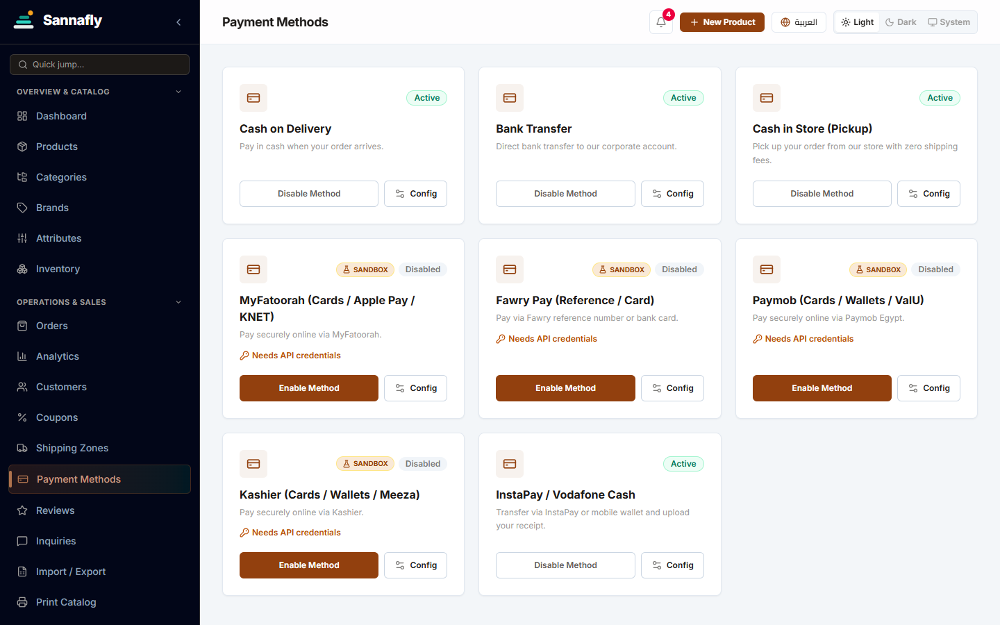
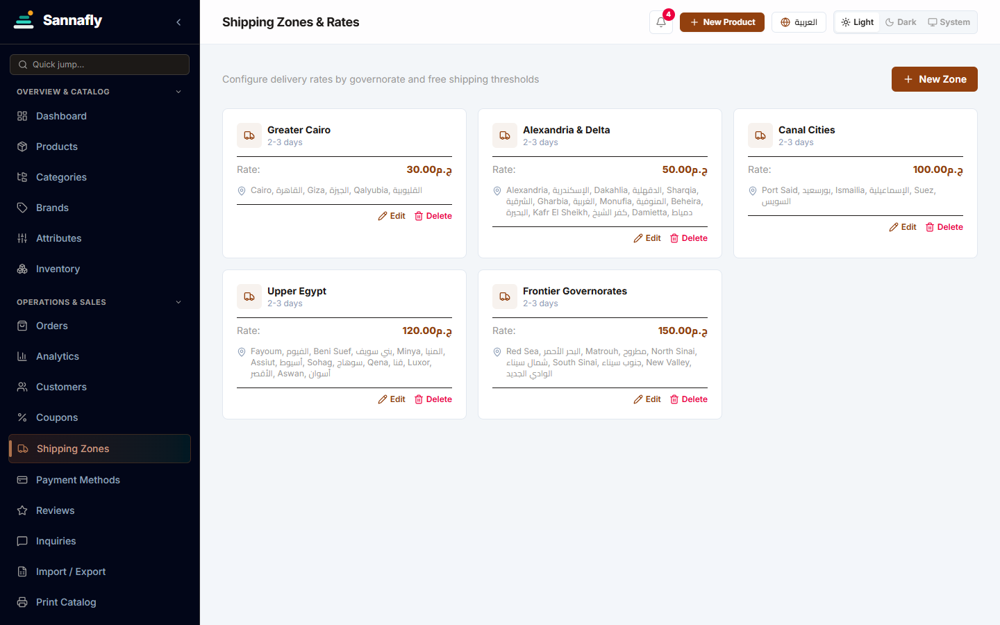

# Payment Methods & Shipping Zones

## 1. What is this section?
- **Payment Methods** (`/admin/payment-methods`): Configure offline and online payment gateways.
- **Shipping Zones** (`/admin/shipping-zones`): Define geographic delivery zones, shipping fees, and free-shipping thresholds.

## 2. Why do I need it?
Customers need accurate delivery costs and trusted local/regional payment options at checkout.

## 3. How do I access it?
- **Payment Methods:** Sidebar → **Operations & Sales** → **Payment Methods** (`/admin/payment-methods`, permission: `payments.manage`)
- **Shipping Zones:** Sidebar → **Operations & Sales** → **Shipping Zones** (`/admin/shipping-zones`, permission: `settings.manage`)

*Payment Methods configuration (`/admin/payment-methods`) supporting COD, Bank Transfer, MyFatoorah, Fawry, Paymob, and Kashier.*

*Shipping Zones manager (`/admin/shipping-zones`) for regional rates and delivery rules.*

## 4. Explain the interface
### Supported Payment Drivers
1. **Cash on Delivery (`cod`)** — Active/inactive toggle, display title (EN/AR), instructions.
2. **Bank Transfer (`bank_transfer`)** — Bank account instructions displayed at checkout.
3. **MyFatoorah (`myfatoorah`)**, **Fawry (`fawry`)**, **Paymob (`paymob`)**, **Kashier (`kashier`)** — Enable/disable toggle, Sandbox vs Live mode, and gateway API credentials (stored securely as encrypted/secret config).

### Shipping Zones
- Zone Name (EN/AR), Shipping Cost, Free Shipping Minimum Order Amount, Estimated Delivery Days, Active toggle.

## 5. How to use it step by step
1. Open `/admin/payment-methods`.
2. Enable **Cash on Delivery** and/or configure an online gateway (e.g., **Paymob** or **MyFatoorah**) with your Sandbox or Live API keys, then click **Save**.
3. Open `/admin/shipping-zones`, create zones (e.g., *Cairo & Giza* = `50`, *Other Governorates* = `85`), and save.

## 6. Practical example
Enable **COD** and **Paymob (Sandbox)** for testing, and create a *Cairo* shipping zone with `50` fee and free shipping over `1000`.

## 7. What happens after I perform the action?
Enabled payment methods and active shipping zones appear dynamically on `/cart` during checkout. Webhook callbacks (`/payments/callback/{driver}`) and return URLs (`/payments/return/{driver}`) automatically reconcile online payment status.

## 8. Important notes
- Payment method updates are blocked in Demo Mode by `demo.guard`.
- In Demo Mode, selecting an online gateway at checkout simulates confirmation without calling external gateway APIs.

## 9. Common problems
- **Online payment gateway fails at checkout:** Verify you entered valid Sandbox/Live credentials, `APP_URL` is reachable for callbacks, and `payments.manage` changes were saved.
