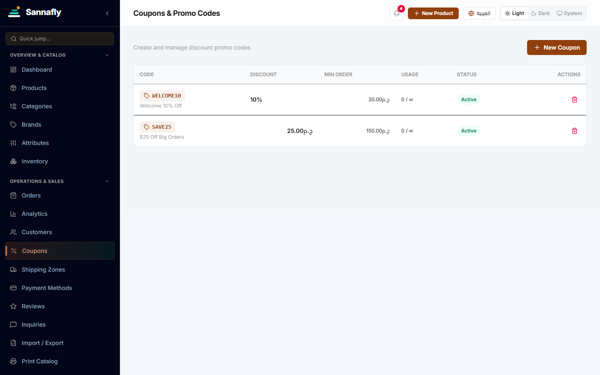

# Pricing & Coupons

## 1. What is this section?
The platform supports **multi-tier pricing** (`PriceType` models such as Regular, Sale, Wholesale, and VIP) per product/variation, plus **promotional discount coupons** (`/admin/coupons`).

## 2. Why do I need it?
You can run seasonal sales using `Sale` prices, display wholesale quantity tiers (`min_quantity`), and issue percentage or fixed-amount coupon codes for marketing campaigns.

## 3. How do I access it?
- **Product Pricing:** Inside **Products → Create / Edit → Step 2 (Pricing & Stock)**
- **Coupons:** Sidebar → **Operations & Sales** → **Coupons** (`/admin/coupons`, permission: `orders.manage`)

*Coupons manager (`/admin/coupons`) for creating and tracking percentage or fixed discount codes.*

## 4. Explain the interface
### Product Pricing Step
- **Regular Price**: Base selling price.
- **Sale Price**: Discounted price (automatically shown with strikethrough regular price when lower than regular price).
- **Advanced Price Tiers**: Toggle to reveal `wholesale` / `vip` / custom price types with `min_quantity` thresholds (enabled when `module_custom_pricing` is active).

### Coupons (`/admin/coupons`)
- **Code**: Uppercase promo code (e.g., `WELCOME10`).
- **Type**: `percentage` (%) or `fixed` (flat currency amount).
- **Value**: Discount amount/percentage.
- **Min Order Amount / Max Uses / Expiry Date / Active Toggle**.

## 5. How to use it step by step (Creating a Coupon)
1. Navigate to `/admin/coupons`.
2. Enter the **Code** (e.g., `SAVE15`), select **Type = Percentage**, and enter **Value = 15**.
3. Set an optional **Minimum Order Amount** and **Expiry Date**.
4. Ensure **Active** is checked and click **Create Coupon**.

## 6. Practical example
Set a product's **Regular Price** to `249.00`, **Wholesale Price** (`min_quantity: 10`) to `195.00`, and create coupon `WELCOME10` for `10%` off at `/cart`.

## 7. What happens after I perform the action?
Customers entering `WELCOME10` on `/cart` see the live discount applied to their subtotal before checkout, and coupon usage counts increment on order placement.

## 8. Important notes
- Coupons require `module_ecommerce` and `module_cart` to be enabled.
- Expired or maxed-out coupons are automatically rejected at `/cart/coupon`.

## 9. Common problems
- **Coupon says invalid:** Check that the coupon is **Active**, not expired, and the cart subtotal meets `min_order_amount`.
