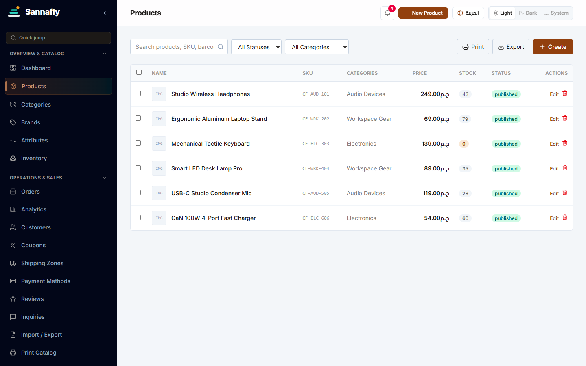
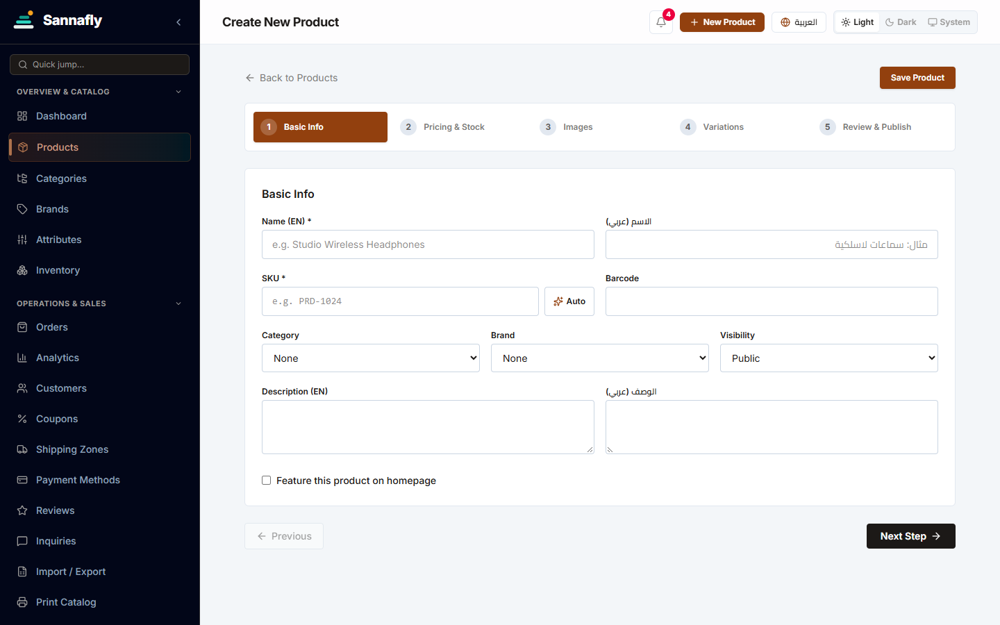
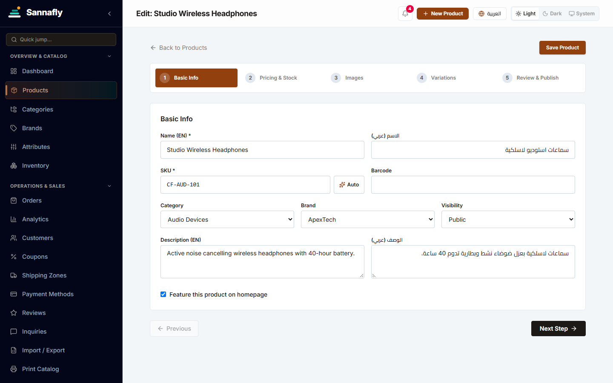
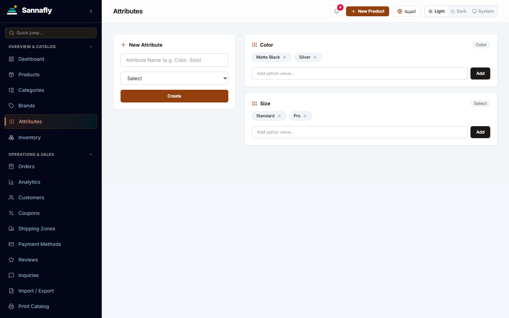
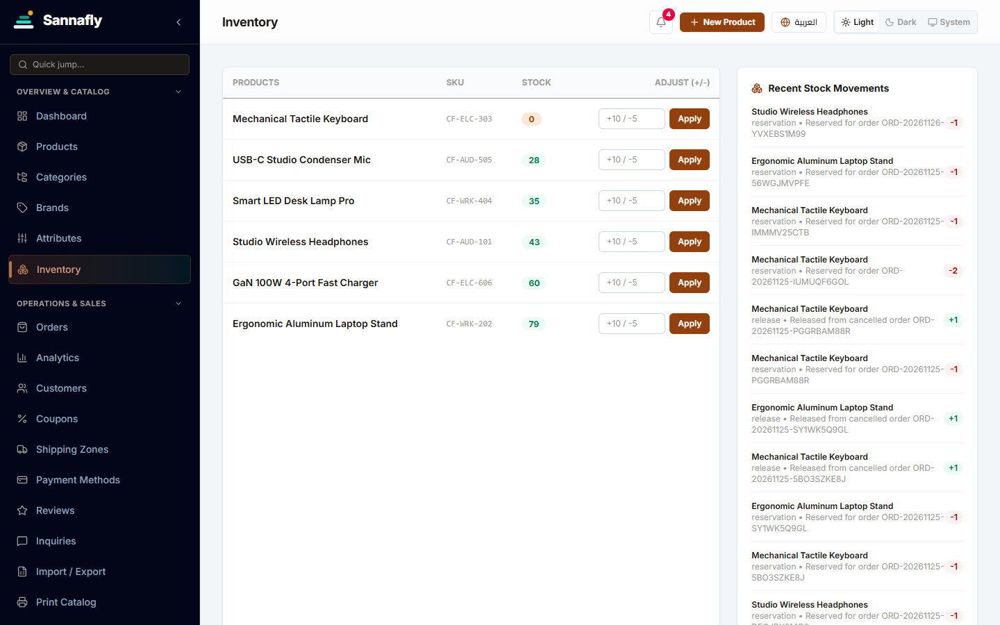

# Products, Images, Variations & Inventory

## 1. What is this section?
The **Products** suite lets you manage your entire product catalog, including multi-step product creation (`/admin/products/create`), image galleries, attribute-based variations, multi-tier pricing, attributes (`/admin/attributes`), and live stock tracking (`/admin/inventory`).

## 2. Why do I need it?
Every item you display or sell—whether simple or with variants like Size/Color—lives here, with full Arabic/English localization, SEO metadata, and stock reservation safety.

## 3. How do I access it?
- **Products List:** Sidebar → **Overview & Catalog** → **Products** (`/admin/products`, permission: `products.view`)
- **Create Product:** Click **New Product** (`/admin/products/create`, permission: `products.create`)
- **Attributes:** Sidebar → **Overview & Catalog** → **Attributes** (`/admin/attributes`, permission: `products.edit`)
- **Inventory:** Sidebar → **Overview & Catalog** → **Inventory** (`/admin/inventory`, permission: `inventory.view`)

*Products index (`/admin/products`) with search, status/category filters, bulk action bar, and per-row edit/print/delete controls.*

## 4. Explain the interface
### Products Index (`/admin/products`)
- **Filters**: Search by name/SKU, filter by **Status** (`published`, `draft`, `archived`), or filter by **Category**.
- **Bulk Actions**: Select checkboxes to publish, unpublish, archive, bulk-update price/stock, or delete selected products.
- **Row Actions**: Edit product, print product sheet (`/admin/print/products/{id}`), or delete (protected by `demo.guard` in Demo Mode).

### 5-Step Product Wizard (`/admin/products/create` & `/admin/products/{id}/edit`)
1. **Step 1 — Basic Info**: English & Arabic Name, Auto-generate **SKU** button, Barcode, Category, Brand, Status (`published`/`draft`/`archived`), Visibility (`public`/`private`), Featured toggle, Short & Full Descriptions (EN/AR), and SEO Title/Description.
2. **Step 2 — Pricing & Stock**: Regular Price, Sale Price, optional Advanced Price Tiers (`wholesale`, `vip`, etc.), Track Inventory toggle, Allow Backorder toggle, Stock Quantity, and Low Stock Threshold.
3. **Step 3 — Images**: Multi-image drag/file upload, preview thumbnails, reorder images, **Set as Main Image** star button, and delete image.
4. **Step 4 — Variations**: Enable `has_variations`, select Attributes & Options (e.g., Color, Size), auto-generate variation combinations with individual SKUs, prices, stock quantities, and variation images.
5. **Step 5 — Review & Publish**: Summary check and **Publish** or **Save as Draft** buttons.

*5-step Product Creation Wizard (`/admin/products/create`).*

*Editing an existing product (`/admin/products/1/edit`) with prefilled fields and gallery controls.*

*Attributes manager (`/admin/attributes`) for defining product options like Color (with hex swatches) and Size.*

*Inventory ledger (`/admin/inventory`) showing current stock, quick +/- adjustments, and recent stock movement history.*

## 5. How to use it step by step (Creating a Product)
1. Go to **Products → New Product** (`/admin/products/create`).
2. Enter the **English Name** and **Arabic Name**, click **Generate SKU**, and choose a **Category** and **Brand**.
3. Click **Next** to go to **Pricing & Stock**, enter the **Regular Price** and **Stock Quantity**.
4. Click **Next** to go to **Images**, upload one or more product photos.
5. (Optional) On **Variations**, enable variations, pick attributes/options, and click **Generate Variations**.
6. On **Review & Publish**, click **Publish Product**.

## 6. Practical example
Create *"Wireless Studio Headphones"* (`CF-AUD-101`) priced at `249.00`, upload 2 photos, mark the front-view photo as the main image, and enable variations for `Matte Black / Standard` and `Silver / Pro`.

## 7. What happens after I perform the action?
- The product is saved inside a database transaction, images are resized/thumbnailed according to Settings (`image_max_width`, `image_thumb_width`, `image_quality`), and if `published` + `public`, it appears immediately on `/catalog`.
- Stock adjustments in `/admin/inventory` create an immutable `StockMovement` record.

## 8. Important notes
- Deleting a product is blocked in Demo Mode by `demo.guard`.
- Products with `track_inventory = true` and `allow_backorder = false` cannot be ordered beyond available stock.

## 9. Common problems
- **Images fail to upload:** Check PHP `upload_max_filesize` / `post_max_size` and ensure `storage/app/public` is linked (`php artisan storage:link`). See [System Health](updates.md).
- **Cannot save variations without SKU:** Each generated variation must have a unique SKU.
