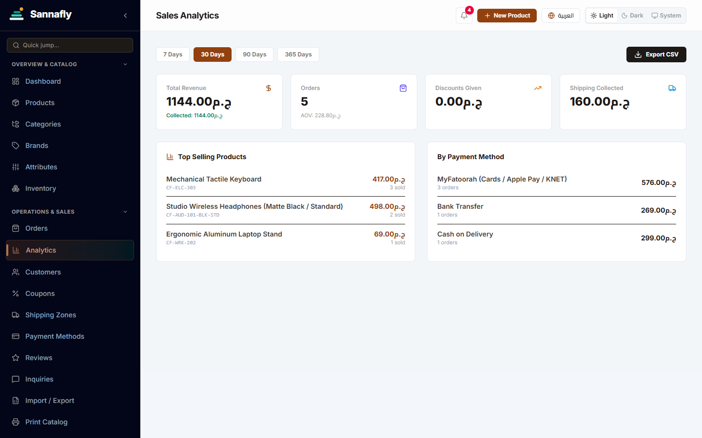
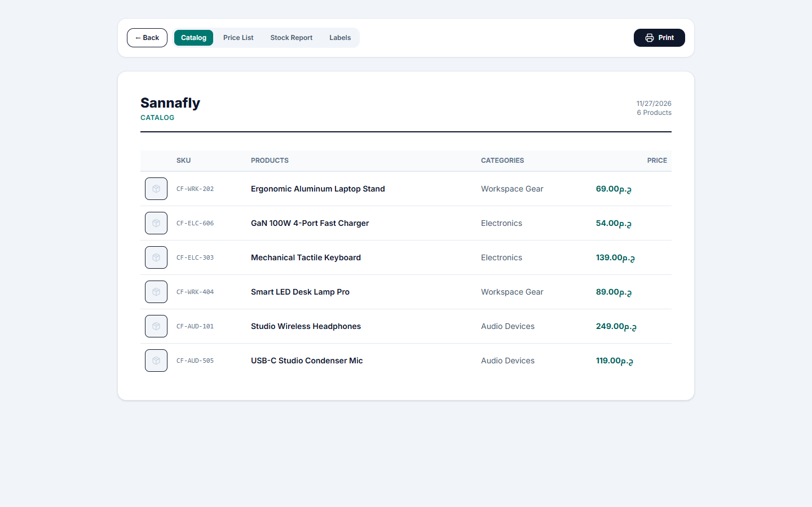

# Reports, Analytics & Printing

## 1. What is this section?
- **Sales Analytics** (`/admin/analytics`): Revenue, order volume, status breakdown, top-selling products, and CSV export (`/admin/analytics/export`).
- **Printable Catalog & Product Sheets** (`/admin/print/catalog`, `/admin/print/products/{id}`): Clean print-ready layouts hiding navigation chrome (`no-print`).

## 2. Why do I need it?
Track store revenue trends, export financial/order summaries for accounting, and print physical catalogs or product spec sheets for B2B buyers.

## 3. How do I access it?
- **Analytics:** Sidebar → **Operations & Sales** → **Analytics** (`/admin/analytics`, permission: `orders.view`)
- **Print Catalog:** Sidebar → **Operations & Sales** → **Print Catalog** (`/admin/print/catalog`, permission: `products.print`)

*Sales Analytics dashboard (`/admin/analytics`) with date filters, revenue metrics, and CSV export.*

*Print-ready Catalog view (`/admin/print/catalog`).*

## 4. Explain the interface
- **Analytics**: Date range selector, KPI summary cards (total revenue, orders, average order value), charts/tables for top products and order statuses, and **Export CSV** button.
- **Print Catalog**: Clean formatted grid of published products with SKU, category, prices, and browser Print trigger (`window.print()`).

## 5. How to use it step by step
1. Open `/admin/analytics`, choose a date range, and review top products and revenue.
2. Click **Export CSV** to download `/admin/analytics/export` for Excel/Google Sheets.
3. Open `/admin/print/catalog` and press `Ctrl+P` (or click **Print**) to save as PDF or print.

## 6. Practical example
At month-end, filter `/admin/analytics` to the last 30 days and export CSV for your accountant.

## 7. What happens after I perform the action?
CSV downloads directly with UTF-8 encoding; print views automatically hide the admin sidebar and top bar.

## 8. Important notes
- Analytics requires `module_ecommerce = true` and `orders.view` permission.

## 9. Common problems
- **Exported CSV shows garbled Arabic in Excel:** Open via Excel **Data → From Text/CSV** and select **UTF-8**.
