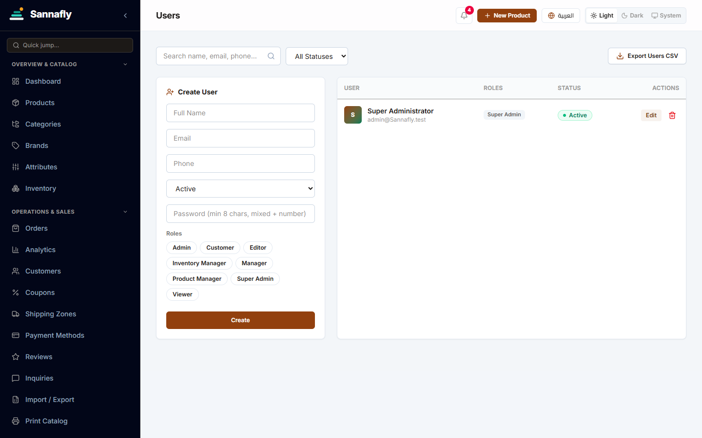
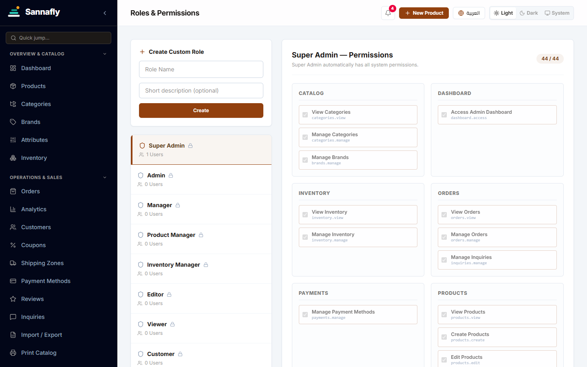
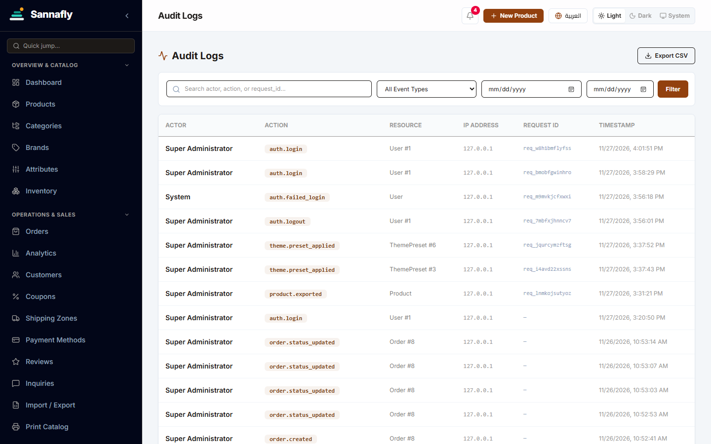
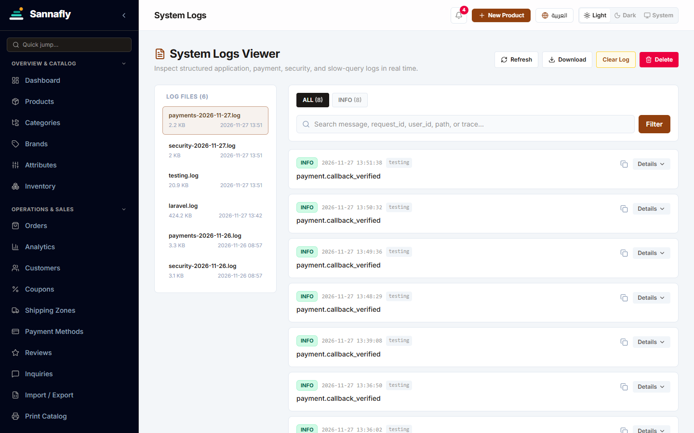

# Users, Roles, Permissions & Audit Logs

## 1. What is this section?
- **Users** (`/admin/users`): Manage admin and staff accounts.
- **Roles & Permissions** (`/admin/roles`): Define roles and granular permission matrices.
- **Audit Logs** (`/admin/system/audit-logs`): Immutable trail of who changed what and when.
- **System Logs** (`/admin/system-logs`): View, download, or clear Laravel application log files.

## 2. Why do I need it?
Prevents unauthorized staff from accessing sensitive areas (like Backups, Settings, or Payments) and gives full accountability for every administrative change.

## 3. How do I access it?
- **Users:** `/admin/users` (`users.view`, `users.create`, `users.edit`, `users.delete`)
- **Roles:** `/admin/roles` (`users.manage_roles`)
- **Audit Logs:** `/admin/system/audit-logs` (`audit_logs.view` / `system.audit_logs.view`)
- **System Logs:** `/admin/system-logs` (`audit_logs.view` to view/download; `settings.manage` to clear/delete)

*Staff Users manager (`/admin/users`) with role assignment, active status, soft-delete/restore, and CSV export.*

*Roles & Permissions matrix (`/admin/roles`) with built-in system roles and custom roles.*

*Audit Logs viewer (`/admin/system/audit-logs`) with action/entity filters and CSV export.*

*System Logs viewer (`/admin/system-logs`) for inspecting `laravel.log` entries.*

## 4. Built-in Roles (from `RbacSeeder`)
- `super-admin` & `admin`: Full access to all permissions.
- `manager`: Catalog, inventory, orders, inquiries, reports, view users.
- `product-manager`: Full product/category/brand/import/print management.
- `inventory-manager`: View products, manage inventory.
- `editor`: Create/edit products, view categories.
- `viewer`: Read-only access to products, categories, inventory, orders.
- `demo-reviewer`: Auto-created when Demo Mode is enabled (read-only preview permissions).

## 5. How to use it step by step
1. Go to `/admin/roles` to create a custom role (e.g., *Order Fulfillment Staff*) and check only `dashboard.access`, `orders.view`, `orders.manage`.
2. Go to `/admin/users`, click **Add User**, enter name/email/password, and assign the role.
3. Periodically review `/admin/system/audit-logs` or export CSV (`/admin/system/audit-logs/export`).

## 6. Important notes
- Destructive actions (`users.destroy`, `roles.destroy`, `system-logs.clear`, `system-logs.destroy`) are protected by `demo.guard`.

## 7. Common problems
- **Staff member gets 403:** Ensure their role includes `dashboard.access` plus the specific route permission, and their user status is `active`.
