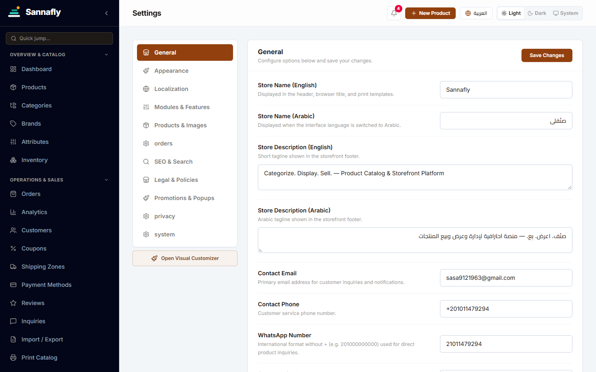

# System Settings (White-Label & Modules)

## 1. What is this section?
**System Settings** (`/admin/settings`) is the master configuration panel controlling store identity, contact info, currency, localization, feature/module toggles, image processing, order expiry TTLs, SEO, and privacy.

## 2. Why do I need it?
Every white-label deployment needs its own brand identity, currency, language defaults, and enabled modules without editing `.env` or code.

## 3. How do I access it?
- **Navigation:** Sidebar → **System & Security** → **Settings**
- **Direct URL:** `/admin/settings`
- **Required Permissions:** `settings.view` to view, `settings.manage` to save.

*System Settings (`/admin/settings`) organized by setting groups.*

## 4. Explain the interface
Settings are grouped logically:
- **General**: `site_name`, `site_name_ar`, `brand_name`, `site_description`, `contact_email`, `support_email`, `contact_phone`, `whatsapp_number`, `store_address`, `currency` (e.g. `EGP`, `USD`, `SAR`), `currency_symbol`, logos, favicon, footer/copyright text, social links.
- **Localization**: `default_locale` (`en` / `ar`), `enable_arabic`, `timezone`, `date_format`, `number_format`.
- **Modules**: Toggle `module_ecommerce`, `module_cart`, `module_checkout`, `module_guest_checkout`, `module_stock`, `module_brands`, `module_variations`, `module_custom_pricing`, `module_whatsapp`, `module_inquiries`.
- **Products**: `default_low_stock_threshold`, `image_max_width`, `image_thumb_width`, `image_quality`, `reviews_verified_only`.
- **Orders**: `unpaid_online_ttl_minutes`, `unpaid_bank_transfer_ttl_minutes`, `unpaid_cod_ttl_minutes`.
- **SEO & Privacy**: `meta_title`, `meta_description`, `cookie_consent_enabled`, `data_retention_days`.

## 5. How to use it step by step
1. Open `/admin/settings`.
2. Update your store name, contact details, currency (`currency` + `currency_symbol`), and default language.
3. Toggle modules as needed (for example, turn off `module_ecommerce` for a pure inquiry catalog).
4. Click **Save Settings**.

## 6. Practical example
Configure a Saudi client store: set `currency = SAR`, `currency_symbol = ر.س`, `timezone = Asia/Riyadh`, `default_locale = ar`, and update `whatsapp_number`.

## 7. What happens after I perform the action?
Changes are saved inside a DB transaction, an `AuditLog` entry (`settings.updated`) is written, and shared Inertia props update immediately across Storefront and Admin.

## 8. Important notes
- Saving settings is blocked in Demo Mode by `demo.guard`.

## 9. Common problems
- **403 when saving:** Your account has `settings.view` but lacks `settings.manage`, or Demo Mode is enabled.
