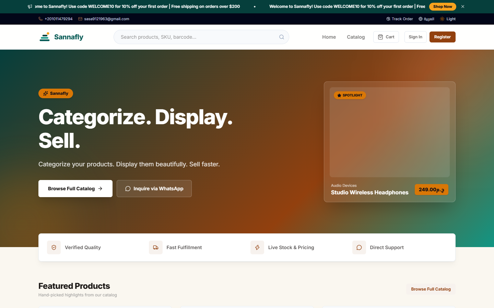
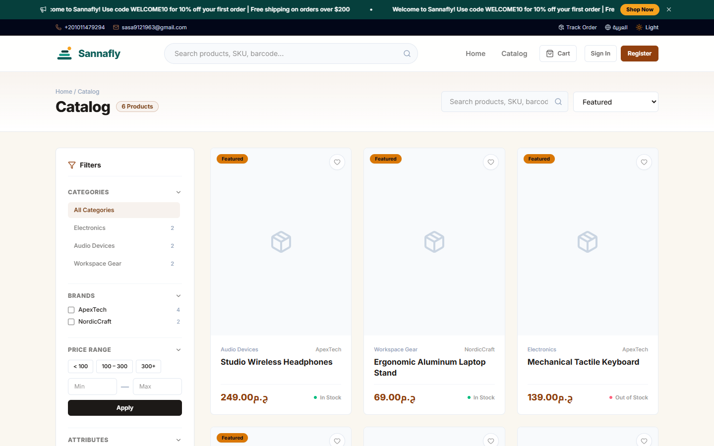
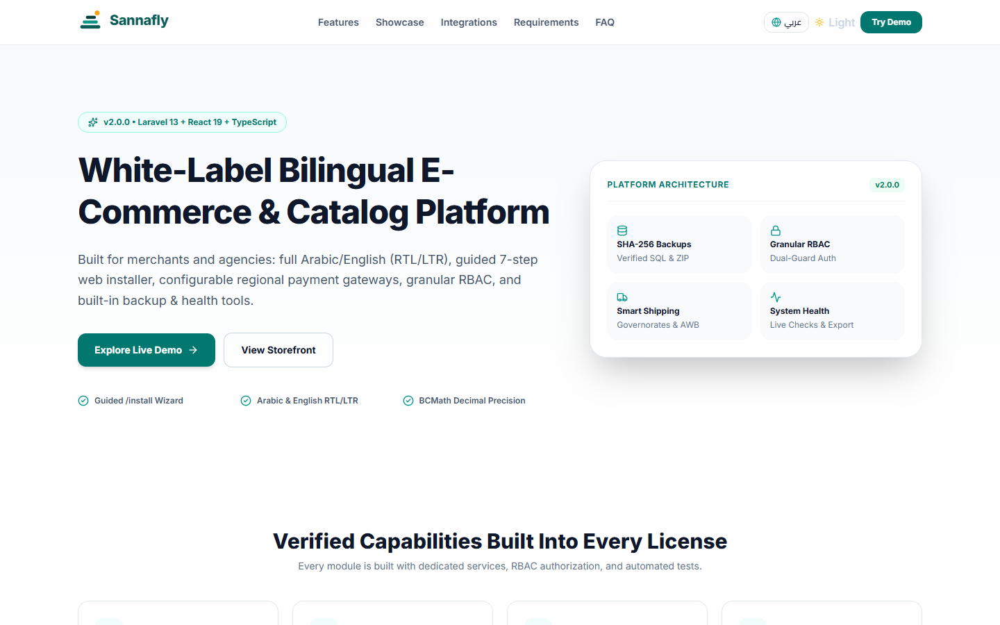

# Storefront & Customer Experience

## 1. What is this section?
The **Storefront** is the public-facing website where visitors browse your catalog, search products, submit inquiries, add items to the cart, place orders, track deliveries, and manage their customer account.

## 2. Storefront Pages & Routes
| Page | URL | Purpose |
| --- | --- | --- |
| Home | `/` | Hero, categories, featured products, promo banner, latest products, brands (order configurable in Customizer) |
| Catalog | `/catalog` | Filterable & searchable product grid (by category, brand, price, sort order) |
| Product Detail | `/products/{slug}` | Gallery, variations, multi-tier pricing, stock badge, Add to Cart, WhatsApp inquiry, reviews, inquiry form |
| Cart & Checkout | `/cart` | Cart items, coupon application, shipping zone calculation, payment method selection, checkout |
| Order Tracking | `/track-order` | Public order status tracker by order number + live polling (`/orders/{orderNumber}/live-status`) |
| Customer Portal | `/login`, `/register`, `/my-orders`, `/profile`, `/wishlist`, `/account/notifications` | Order history, cancellation, saved addresses, wishlist, data export/anonymization, live notifications |
| Info & Legal | `/about`, `/contact`, `/policies/{slug}` | Store info, contact page, Privacy/Terms/Return policies |
| Commercial Landing | `/product` | Bilingual product showcase page for commercial buyers |
| Live Demo Hub | `/demo` | Sandboxed evaluation hub for storefront & admin reviewer |

*Public Storefront Homepage (`/`) reflecting active white-label branding, theme colors, and section layout.*

*Storefront Catalog (`/catalog`) with sidebar filters, search, and responsive product cards.*

*Commercial Product Landing Page (`/product`) showcasing verified capabilities in Arabic and English.*

## 3. Important Notes
- Customer accounts use the `customer` guard and are strictly isolated from `/admin/*`.
- If `module_ecommerce` is disabled, cart and checkout are hidden and visitors interact via WhatsApp and the Product Inquiry form.
