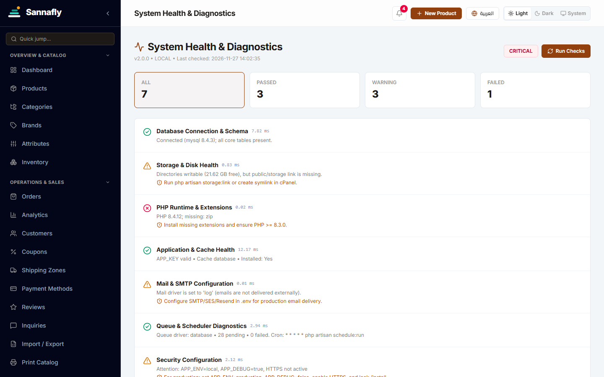
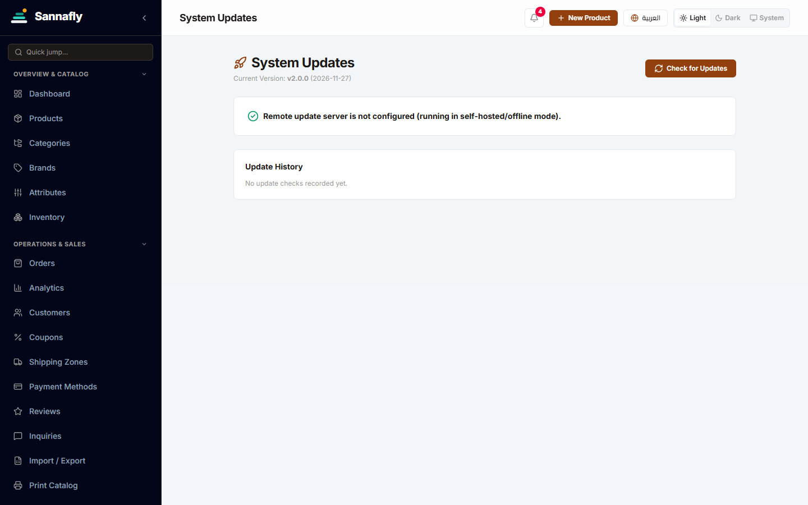

# System Health & Updates

## 1. What is this section?
- **System Health & Diagnostics** (`/admin/system/health`): Runs live checks on PHP version, extensions, database connectivity, storage permissions, `storage:link`, queue/mail config, and sends a Test Email.
- **System Updates** (`/admin/system/updates`): Checks current version, release manifest, pre-flight readiness, and executes migrations/update steps safely.

## 2. Why do I need it?
Diagnoses server misconfigurations immediately after installation or migration, and keeps client installations up to date without needing SSH for routine checks.

## 3. How do I access it?
- **System Health:** `/admin/system/health` (`system.health.view` / `settings.manage`)
- **System Updates:** `/admin/system/updates` (`system.updates.view` / `settings.manage`)

*System Health & Diagnostics (`/admin/system/health`) showing overall status, individual server checks, and Test Mail sender.*

*System Updates (`/admin/system/updates`) showing installed version, update check, and execution controls.*

## 4. How to use it step by step
1. Open `/admin/system/health` and inspect any **Warning** or **Error** badges (e.g., missing symlink or writable directory).
2. Enter your email address in the **Send Test Mail** box and click **Send** to verify SMTP delivery.
3. Open `/admin/system/updates`, click **Check for Updates**, review release notes, take a backup first, and click **Execute Update** if an update is available.

## 5. Important notes
- **Test Mail** and **Execute Update** are blocked in Demo Mode (`demo.guard`).

## 6. Common problems
- **Test Mail fails:** Verify `MAIL_MAILER`, `MAIL_HOST`, `MAIL_PORT`, `MAIL_USERNAME`, and `MAIL_PASSWORD` in `.env`.
